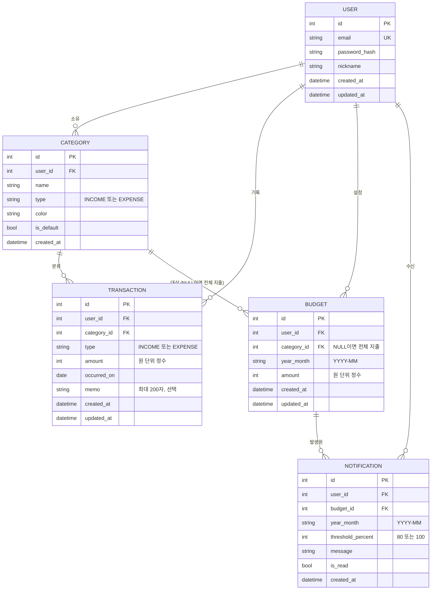
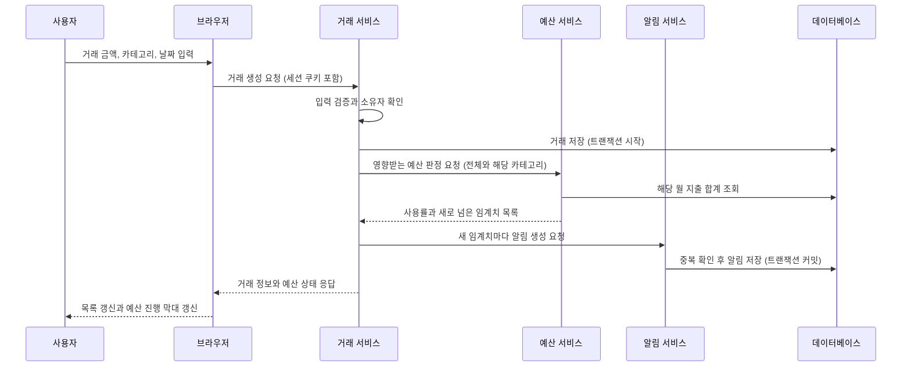
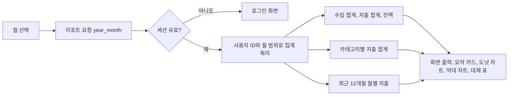

# 가계부 앱 요구 사항 및 기획서

- 작성일: 2026-11-06
- 상태: 확정 (2026-11-06, 아래 "확정 결정" 참고)

## 확정 결정 (2026-11-06)

사용자가 다음을 정했습니다. 이 결정이 10장의 권장안보다 우선합니다.
- 백엔드: Python, FastAPI, SQLAlchemy, Pydantic, pytest (Q-01 변경: Next.js 안 대신)
- 프런트엔드: React + Vite + TypeScript (Q-01 변경)
- 데이터베이스: SQLite (파일 DB, 개인용 MVP). 나중에 PostgreSQL로 옮길 수 있게 SQLAlchemy로 접근합니다.
- 나머지 열린 질문 Q-02~Q-13은 권장 답안을 채택합니다.
- 앱 코드 구조: `ledger-app/backend/`(Python), `ledger-app/frontend/`(React). 11장의 Next.js 관련 항목은 이 구조로 대체합니다.
- API 계약: `docs/api-contract.md`
- 관련 문서/출처:
  - `C:\Users\great\VibeProj\DG_AI\p6_1Agent\계획_agent.md` (planner 에이전트 비교 문서)
  - `C:\Users\great\VibeProj\DG_AI\p6_1Agent\.claude\agents\planner.md`
  - `C:\Users\great\VibeProj\DG_AI\p6_1Agent\.claude\commands\planner.md`
  - WCAG 2.2 (W3C Recommendation, 2023년 10월 발행) - 접근성 기준
  - Core Web Vitals 권장 기준 (LCP 2.5초 이하 "양호") - 성능 기준

---

## 0. 현재 프로젝트 상태 (사전 확인 결과)

- 애플리케이션 소스 코드: **없음**. 현재 디렉터리에는 구현 코드가 없습니다.
- 기존 파일: `.claude/agents/` (developer, planner, orchestrator, ui-designer), `.claude/commands/` (build, dev, design, planner), `계획_agent.md`.
- `docs/` 폴더: **없음**. 이 기획서 저장 시 `docs/planning/` 를 새로 만듭니다.
- 기존 기술 스택, 패키지 파일, 설정 파일(`package.json` 등): **없음**. 따라서 기술 스택에 대한 기존 제약은 없습니다.
- 기존 기획 문서와의 충돌: 없음.

---

## 1. 개요

### 1.1 배경과 문제
개인이 매달 얼마를 벌고 어디에 쓰는지 한눈에 파악하기 어렵고, 예산을 세워도 초과 사실을 월말에야 알게 되는 문제가 있습니다. 가계부 앱은 수입과 지출을 빠짐없이 기록하고, 카테고리별로 분류하고, 월별 지출 추이를 그래프로 보여주며, 예산 초과 시 즉시 알려줌으로써 지출을 통제할 수 있게 돕습니다.

### 1.2 한 줄 정의
"로그인한 개인이 수입과 지출을 기록·분류하고, 월별 지출을 그래프로 확인하며, 예산 초과 시 알림을 받는 개인 가계부 웹 앱"

---

## 2. 목표와 성공 기준

### 2.1 목표
| ID | 목표 |
|---|---|
| G-01 | 사용자가 수입/지출 거래를 빠르고 정확하게 기록·수정·삭제할 수 있다. |
| G-02 | 거래를 카테고리로 분류하고, 사용자가 카테고리를 관리할 수 있다. |
| G-03 | 월별 지출 현황을 그래프와 표로 파악할 수 있다. |
| G-04 | 카테고리(또는 전체) 단위 월 예산을 정하고, 초과 시 알림을 받는다. |
| G-05 | 사용자별로 데이터가 완전히 분리되며, 안전하게 로그인할 수 있다. |

### 2.2 성공 기준 (측정 가능)
| ID | 기준 | 측정 방법 |
|---|---|---|
| SC-01 | 거래 1건(금액, 카테고리, 날짜 입력 후 저장)을 평균 15초 이내에 완료한다. | 사용성 점검 시나리오 5회 평균 측정 (권장 목표값) |
| SC-02 | 거래 저장 후 예산 판정과 알림 생성까지 1초 이내 (p95) 완료한다. | 거래 10,000건이 있는 테스트 계정에서 100회 측정 |
| SC-03 | 월별 리포트(그래프 + 합계) 화면이 p95 기준 2.5초 이내 표시된다. | 거래 10,000건 기준 측정 (LCP 권장 기준 준용) |
| SC-04 | 예산 초과 판정 누락이 0건이다. | 예산 경계값(79%, 80%, 100%, 100% 초과) 자동 테스트 전건 통과 |
| SC-05 | 사용자 간 데이터 접근이 0건이다. | 타 사용자 ID로 조회, 수정, 삭제를 시도하는 자동 테스트 전건 거부 |
| SC-06 | MVP 필수 기능(FR 중 MVP 표시 항목)이 모두 동작한다. | 검증 계획(12장)의 항목별 통과 여부 |
| SC-07 | 주요 사용 시나리오 5개(가입, 거래 입력, 리포트 확인, 예산 설정, 알림 확인)를 오류 없이 완료한다. | E2E 테스트 통과 |

---

## 3. 사용자와 시나리오

### 3.1 대상 사용자
- 주 사용자: 월 급여 또는 용돈을 받고 생활비를 관리하려는 개인 (1인 1계정).
- 사용 환경: PC 브라우저와 모바일 브라우저 (반응형). 네이티브 앱은 MVP 범위가 아닙니다.

### 3.2 사용 시나리오
| 시나리오 | 설명 |
|---|---|
| S-01 최초 사용 | 이메일로 가입하고 로그인한 뒤, 기본 카테고리 목록을 확인한다. |
| S-02 일상 기록 | 점심 식사 후 지출 1건을 카테고리 "식비"로 입력한다. |
| S-03 수입 기록 | 월급일에 "급여" 수입을 입력한다. |
| S-04 수정과 삭제 | 잘못 입력한 금액을 고치고, 중복 거래 하나를 삭제한다. |
| S-05 월말 점검 | 지난달로 이동해 카테고리별 지출 비율과 월별 추이 그래프를 본다. |
| S-06 예산 설정 | 이번 달 전체 예산과 "식비" 예산을 설정한다. |
| S-07 초과 알림 | "식비" 사용액이 예산의 80%에 도달하면 알림을 받고, 100%를 넘으면 다시 알림을 받는다. |
| S-08 탈퇴 | 설정 화면에서 계정과 모든 데이터를 삭제한다. |

---

## 4. 기능 요구 사항 (FR)

표기 규칙: 각 항목은 **입력 → 처리 → 출력** 순으로 기술합니다. 우선순위는 MVP(필수) 또는 P2(이후 단계)입니다.

### 4.1 회원 및 인증

**FR-01 회원가입 (MVP)**
- 입력: 이메일, 비밀번호, 비밀번호 확인, 닉네임
- 처리: 이메일 형식 검증, 이메일 중복 검사(대소문자 무시), 비밀번호 규칙 검사(8자 이상, 영문과 숫자 포함, 권장안), 비밀번호 해시 저장, 기본 카테고리 세트 생성
- 출력: 가입 완료 후 자동 로그인하고 대시보드로 이동. 실패 시 항목별 오류 메시지 표시.

**FR-02 로그인 (MVP)**
- 입력: 이메일, 비밀번호
- 처리: 계정 조회, 해시 비교, 실패 횟수 집계 (10분 내 5회 실패 시 15분 잠금, 권장안), 세션 생성
- 출력: 세션 쿠키 발급 후 대시보드로 이동. 실패 시 "이메일 또는 비밀번호가 올바르지 않습니다"만 표시 (계정 존재 여부 노출 금지).

**FR-03 로그아웃 (MVP)**
- 입력: 로그아웃 버튼 클릭
- 처리: 서버 세션 무효화, 쿠키 삭제
- 출력: 로그인 화면으로 이동. 이후 보호 화면 접근 시 로그인 화면으로 리디렉션.

**FR-04 회원 탈퇴 (MVP)**
- 입력: 비밀번호 재확인, 탈퇴 확인 체크
- 처리: 계정, 거래, 카테고리, 예산, 알림, 세션을 모두 삭제 (즉시 삭제, 6장 제약 참고)
- 출력: 탈퇴 완료 메시지 후 로그인 화면으로 이동. 삭제 후 같은 이메일로 재가입 가능.

**FR-05 비밀번호 재설정 (P2)**
- 입력: 가입 이메일
- 처리: 1회용 재설정 링크 발급 (유효 30분, 권장안), 메일 발송, 새 비밀번호 저장
- 출력: 새 비밀번호로 로그인 가능. 이 기능은 메일 발송 인프라가 필요하므로 P2로 둡니다 (열린 질문 Q-03).

### 4.2 카테고리

**FR-06 기본 카테고리 제공 (MVP)**
- 입력: 신규 가입 이벤트
- 처리: 기본 카테고리 세트를 사용자 계정에 복사 (지출: 식비, 카페/간식, 교통, 주거/관리비, 통신, 쇼핑, 문화/여가, 의료/건강, 교육, 경조사, 기타 지출 / 수입: 급여, 부수입, 용돈, 기타 수입)
- 출력: 카테고리 관리 화면에 기본 카테고리 표시. 기본 카테고리도 이름 변경과 삭제가 가능합니다.

**FR-07 카테고리 추가 (MVP)**
- 입력: 카테고리 이름 (1~20자, 같은 유형 내 중복 불가), 유형 (수입 또는 지출), 색상 (선택, 팔레트 중 선택)
- 처리: 이름 공백 제거, 중복 검사, 사용자 범위 내 저장
- 출력: 목록에 즉시 추가. 중복이면 오류 메시지 표시.

**FR-08 카테고리 수정 (MVP)**
- 입력: 카테고리 ID, 새 이름, 새 색상
- 처리: FR-07과 같은 검증. 유형(수입/지출)은 거래가 없을 때만 변경 가능 (권장안).
- 출력: 목록과 기존 거래 표시에 반영.

**FR-09 카테고리 삭제 (MVP)**
- 입력: 삭제할 카테고리, 대체 카테고리 (해당 카테고리에 거래 또는 예산이 있을 때 필수)
- 처리: 대체 카테고리로 거래를 일괄 이동하고, 해당 카테고리의 예산은 삭제. 같은 유형의 카테고리만 대체 가능.
- 출력: 삭제 완료 메시지. 거래 수와 이동 결과를 확인 창에 미리 표시.

### 4.3 수입과 지출 거래

**FR-10 거래 기록 (MVP)**
- 입력: 유형 (수입 또는 지출, 필수), 금액 (정수 원, 1원 이상 999,999,999원 이하, 필수), 날짜 (기본값 오늘, 미래 날짜 입력 불가), 카테고리 (필수, 유형에 맞는 카테고리만 선택), 메모 (선택, 최대 200자)
- 처리: 입력 검증 (서버에서도 재검증), 사용자 소유 확인, 거래 저장, 저장 후 예산 판정 (FR-18~FR-19 호출)
- 출력: 거래 목록에 즉시 추가. 예산이 설정된 경우 해당 예산의 사용률을 함께 갱신.

**FR-11 거래 목록 조회 (MVP)**
- 입력: 기간 (월 단위 또는 시작일~종료일), 유형 필터 (전체, 수입, 지출), 카테고리 필터 (다중 선택 가능), 정렬 (날짜 최신순 기본, 금액순)
- 처리: 사용자 범위로 필터링, 페이지당 20건 (권장안) 단위 조회
- 출력: 날짜, 유형, 카테고리, 금액, 메모 목록과 페이지 이동. 결과가 없으면 "거래가 없습니다" 안내.

**FR-12 거래 수정 (MVP)**
- 입력: 거래 ID, 변경할 항목 (FR-10과 같은 검증)
- 처리: 소유 확인, 수정 저장, 이전 월과 새 월 모두의 예산 사용률 재계산. 알림은 재계산 결과로 취소되지 않습니다 (가정 A-09).
- 출력: 목록과 리포트에 반영되고, 예산 사용률이 갱신됨.

**FR-13 거래 삭제 (MVP)**
- 입력: 거래 ID, 삭제 확인 (확인 창 필수)
- 처리: 소유 확인, 삭제, 예산 사용률 재계산
- 출력: 목록에서 제거되고 리포트에 반영됨. 삭제는 복구 불가 (열린 질문 Q-05).

### 4.4 월별 리포트와 그래프

**FR-14 월 선택 이동 (MVP)**
- 입력: 이전 달, 다음 달 버튼 또는 월 선택 (미래 월 선택 불가)
- 처리: 선택 월의 기간 계산 (Asia/Seoul 기준, 1일 00:00 ~ 말일 23:59:59)
- 출력: 해당 월의 리포트 화면 갱신.

**FR-15 월 요약 (MVP)**
- 입력: 선택 월
- 처리: 수입 합계, 지출 합계, 잔액 (수입 - 지출) 계산
- 출력: 상단 요약 카드 3개 (수입, 지출, 잔액). 거래가 없으면 0원으로 표시.

**FR-16 카테고리별 지출 분류 그래프 (MVP)**
- 입력: 선택 월
- 처리: 카테고리별 지출 합계와 비율 계산 (금액 내림차순)
- 출력: 도넛 차트와 같은 내용의 표 (표는 접근성용 대체 수단으로 함께 제공). 0원 카테고리는 제외.

**FR-17 월별 지출 추이 그래프 (MVP)**
- 입력: 기준 월 (기본값 선택 월), 조회 기간 (최근 6개월 또는 12개월, 기본 12개월)
- 처리: 월별 지출 합계 집계 (거래가 없는 월은 0원)
- 출력: 막대 그래프 (월별 지출) 와 같은 내용의 표. 막대 클릭 시 해당 월로 이동 (P2 검토 가능).

### 4.5 예산

**FR-18 예산 설정 (MVP)**
- 입력: 대상 (전체 지출 또는 특정 지출 카테고리), 대상 월, 금액 (정수 원, 1원 이상)
- 처리: 같은 대상과 같은 월에 예산이 이미 있으면 덮어쓰기 (확인 창). 수입 카테고리는 예산 대상에서 제외 (가정 A-07).
- 출력: 예산 목록에 표시. 설정 직후 현재 사용액 기준 사용률을 계산해 보여줌.

**FR-19 예산 사용률 표시 (MVP)**
- 입력: 선택 월
- 처리: 대상별 지출 합계 / 예산 금액 × 100 (소수점 첫째 자리 반올림, 표시는 정수 %)
- 출력: 예산별 진행 막대와 "사용 금액 / 예산 금액 (사용률 %)" 텍스트. 상태 구분 (정상 0~79%, 주의 80~99%, 초과 100% 이상)은 색상과 텍스트를 함께 표시.

**FR-20 예산 초과 판정 (MVP)**
- 입력: 거래 저장, 수정, 삭제 이벤트
- 처리: 영향을 받는 예산 (전체 예산 포함)의 사용률을 계산하고 임계치 80%, 100%를 넘었는지 판정
- 출력: 판정 결과를 FR-21에 전달. 임계치를 넘지 않았으면 아무 동작도 하지 않음.

**FR-21 예산 알림 생성 (MVP)**
- 입력: FR-20의 판정 결과 (예산 ID, 월, 임계치 80% 또는 100%)
- 처리: 같은 예산, 같은 월, 같은 임계치 알림이 이미 있으면 생성하지 않음 (중복 방지). 새로 임계치를 넘었을 때만 생성.
- 출력: 알림 1건 생성. 예시 문구: "10월 전체 예산의 80%를 사용했습니다 (400,000원 / 500,000원)."

**FR-22 인앱 알림 확인 (MVP)**
- 입력: 알림 목록 화면 진입, 알림 클릭 또는 "모두 읽음" 버튼
- 처리: 알림 목록 조회 (최신순), 읽음 처리
- 출력: 읽지 않은 알림 개수를 상단 아이콘에 표시. 알림 클릭 시 관련 예산 화면으로 이동.

### 4.6 이후 단계 (P2)

| ID | 기능 | 입력 → 처리 → 출력 요약 |
|---|---|---|
| FR-23 | 이메일 또는 브라우저 푸시 알림 | 알림 생성 시 메일 또는 푸시 발송 → 채널 설정 확인 → 발송 결과 기록 |
| FR-24 | 소셜 로그인 (Google 등) | 외부 인증 제공자 로그인 → 계정 연결 또는 생성 → 세션 발급 |
| FR-25 | 거래 키워드 검색 | 검색어 (메모, 카테고리 이름) → 부분 일치 조회 → 목록 출력 |
| FR-26 | 예산 복사 | 전월 예산 선택 → 대상 월로 복사 (덮어쓰기 확인) → 예산 목록 갱신 |
| FR-27 | CSV 내보내기 | 기간 선택 → 거래 목록을 CSV로 생성 → 파일 다운로드 |
| FR-28 | 반복 거래 (월세, 구독료) | 반복 규칙 입력 → 매월 예정 거래 생성 → 거래 목록에 표시 |
| FR-29 | 전월 대비 비교 | 선택 월과 전월 합계 비교 → 증감액과 증감률 표시 |
| FR-30 | PWA 설치 (홈 화면 추가) | 설치 요청 → 매니페스트와 서비스 워커 등록 → 앱처럼 실행 |

---

## 5. 비기능 요구 사항 (NFR)

| ID | 분류 | 요구 사항 | 기준 (권장안) |
|---|---|---|---|
| NFR-01 | 보안 | 비밀번호는 단방향 해시 (Argon2id 또는 bcrypt)로 저장하고, 평문을 로그나 응답에 남기지 않는다. | 해시 알고리즘과 파라미터 코드 리뷰 통과 |
| NFR-02 | 보안 | 세션 쿠키는 HttpOnly, Secure, SameSite=Lax 속성을 갖는다. | 브라우저 개발자 도구에서 속성 확인 |
| NFR-03 | 보안 | 세션 유효 기간은 14일 (미사용 시 만료), 로그아웃 시 즉시 무효화한다. | 자동 테스트 |
| NFR-04 | 보안 | 모든 데이터 조회와 변경 쿼리는 로그인 사용자 ID 조건을 포함한다 (행 단위 접근 통제). | 타 사용자 데이터 접근 시도 테스트 전건 거부 (SC-05) |
| NFR-05 | 보안 | 상태 변경 요청(POST, PUT, DELETE)에 CSRF 방어를 적용한다. | 자동 테스트 |
| NFR-06 | 보안 | 모든 입력은 서버에서 다시 검증한다 (클라이언트 검증만으로 신뢰하지 않음). | 검증 스키마 단위 테스트 |
| NFR-07 | 보안 | 로그인 실패 횟수 제한 (FR-02) 과 주요 API 요청 속도 제한을 둔다. | 10분 내 5회 실패 시 잠금 테스트 |
| NFR-08 | 보안 | 전 구간 HTTPS 사용, 보안 헤더 (CSP, HSTS 등) 적용. | 배포 환경 헤더 점검 |
| NFR-09 | 개인정보 | 수집 항목은 이메일, 닉네임, 비밀번호 해시로 최소화한다. 실명, 전화번호, 주민등록번호, 계좌번호는 수집하지 않는다. | 가입 폼과 DB 스키마 검토 |
| NFR-10 | 개인정보 | 금액, 메모 등 거래 내용은 민감 정보로 취급한다. 로그, 에러 추적 도구, 분석 도구에 거래 내용을 전송하지 않는다. | 로그 샘플 점검 |
| NFR-11 | 개인정보 | 회원 탈퇴 시 해당 사용자의 모든 개인정보와 거래 데이터를 삭제한다. 백업에 남는 기간은 명시한다 (Q-07). | 탈퇴 후 DB 조회 0건 확인 |
| NFR-12 | 개인정보 | 공개 배포 시 개인정보 처리방침을 게시하고, 가입 시 동의를 받는다. 제3자 제공은 하지 않는다. | 배포 전 체크리스트 |
| NFR-13 | 성능 | 월 리포트 화면의 p95 표시 시간 2.5초 이내 (거래 10,000건 기준). | SC-03 |
| NFR-14 | 성능 | 거래 저장 API의 p95 응답 시간 500ms 이내 (예산 판정 포함). | 부하 테스트 (k6 등 도구는 도입 시 확인) |
| NFR-15 | 성능 | 거래 목록은 페이지 단위 조회로 전체 데이터를 한 번에 불러오지 않는다. | 코드 리뷰, 쿼리 로그 확인 |
| NFR-16 | 접근성 | WCAG 2.2 AA 수준을 목표로 한다. 키보드만으로 모든 기능을 조작할 수 있다. | 자동 점검 도구와 수동 키보드 테스트 |
| NFR-17 | 접근성 | 차트는 같은 내용의 표를 함께 제공한다. 색상만으로 상태를 구분하지 않는다 (텍스트 또는 아이콘 병행). | 점검 체크리스트 |
| NFR-18 | 접근성 | 텍스트와 배경의 명도 대비 4.5:1 이상. 폼 입력에는 label을 연결하고, 오류 메시지는 스크린 리더가 읽을 수 있게 한다. | 자동 점검 도구 |
| NFR-19 | 호환성 | 최신 두 버전의 Chrome, Edge, Firefox, Safari (데스크톱과 모바일) 에서 동작한다. | 수동 테스트 매트릭스 |
| NFR-20 | 호환성 | 화면 너비 360px 이상에서 레이아웃이 깨지지 않는다 (반응형). | 브라우저 개발자 도구 점검 |
| NFR-21 | 가용성 | 월 가용성 99.0% 이상 (개인 프로젝트 기준 권장안). 일 1회 자동 백업, 보관 7일. | 배포 후 모니터링 |
| NFR-22 | 유지보수성 | TypeScript 엄격 모드, 린트와 포맷터 적용, 계층 분리 (화면, 서비스, 저장소). | CI 린트와 타입 검사 통과 |
| NFR-23 | 유지보수성 | 데이터베이스 스키마 변경은 마이그레이션 파일로만 관리한다. | 마이그레이션 이력 확인 |
| NFR-24 | 국제화 | 통화는 원(KRW)으로 고정하고 소수점 없이 저장한다. 날짜와 시간은 Asia/Seoul 기준으로 표시한다. UI는 한국어만 제공한다. | 금액 계산 단위 테스트 |
| NFR-25 | 관측성 | 서버 오류는 기록하되, 거래 금액과 메모는 기록하지 않는다. | 로그 점검 (NFR-10과 연계) |

---

## 6. 제약 조건

| 구분 | 제약 |
|---|---|
| 플랫폼 | 웹 브라우저 기반, 반응형 (가정 A-01). 네이티브 앱은 MVP에서 제외. |
| 기술 스택 | 기존 제약 없음. 10장에서 비교 후 추천안 제시. 사용자 확정 필요 (Q-01). |
| 인증 | 이메일과 비밀번호 로그인이 MVP 기본. 외부 인증은 P2. |
| 금액 단위 | 원 단위 정수. 소수점 금액 입력 금지. |
| 시간대 | Asia/Seoul 고정. |
| 데이터 격리 | 1인 1계정. 가족 공유, 다중 사용자 공유 계정은 MVP 범위 밖. |
| 예산 | 개인 자금과 관련한 조언, 투자 추천 기능은 제공하지 않음. |
| 일정과 예산 | 사용자가 일정과 예산을 명시하지 않음. 개인 프로젝트 가정 (A-12). |
| 외부 서비스 | 호스팅, 데이터베이스, 메일 발송 등의 외부 서비스 사양과 요금은 도입 시점에 공식 문서로 재확인 필요. 이 문서는 특정 요금이나 한도를 사실로 쓰지 않음. |

---

## 7. 범위 (MVP / 이후 / 제외)

### 7.1 MVP 포함
- FR-01 ~ FR-04 (회원가입, 로그인, 로그아웃, 탈퇴)
- FR-06 ~ FR-09 (기본 카테고리, 카테고리 추가, 수정, 삭제)
- FR-10 ~ FR-13 (거래 기록, 목록, 수정, 삭제)
- FR-14 ~ FR-17 (월 이동, 월 요약, 카테고리별 그래프, 월별 추이 그래프)
- FR-18 ~ FR-22 (예산 설정, 사용률, 초과 판정, 알림 생성, 인앱 알림 확인)
- NFR-01 ~ NFR-12, NFR-13 ~ NFR-18, NFR-19 ~ NFR-24 (MVP 기준 충족)

### 7.2 이후 단계 (Phase 2)
- FR-05 비밀번호 재설정
- FR-23 이메일 또는 푸시 알림
- FR-24 소셜 로그인
- FR-25 키워드 검색
- FR-26 예산 복사
- FR-27 CSV 내보내기
- FR-28 반복 거래
- FR-29 전월 대비 비교
- FR-30 PWA 설치
- 2단계 인증 (2FA)

### 7.3 하지 않을 것 (Out of scope)
- 네이티브 모바일 앱 (iOS, Android 스토어 배포)
- 계좌 연동, 카드 명세서 자동 수집 (은행 API 연동)
- 자산 관리 (주식, 부동산, 대출 상환 계산)
- 다중 통화, 환율
- 가족 또는 여러 사용자 간 공유
- 세금 계산, 연말정산 기능
- 금융 조언, 투자 추천
- 영수증 사진 OCR
- 다국어 (한국어만)

---

## 8. 가정 (Assumptions)

| ID | 가정 내용 | 근거 |
|---|---|---|
| A-01 | 1차 플랫폼은 반응형 웹이다. | 설명에 모바일 전용 요구가 없고, 웹이 가장 빠르게 검증 가능함. 모바일 필요 시 Q-02로 확인. |
| A-02 | 사용자는 1인 1계정이며, 한국어 UI와 원화(KRW)를 쓴다. | 설명의 "개인 가계부" 문구. |
| A-03 | 로그인은 이메일과 비밀번호 방식으로 시작한다. | 가장 단순하고 외부 의존이 없음. |
| A-04 | 알림은 앱 안의 알림 목록으로만 제공한다 (MVP). | 메일 발송과 푸시 인프라가 추가로 필요함. |
| A-05 | 거래 입력은 수동 입력만 지원한다 (계좌 연동, 자동 수집 없음). | 설명에 자동화 요구가 없음. |
| A-06 | 카테고리는 수입과 지출 유형을 각각 가지며, 기본 카테고리 세트를 제공한다. | 설명의 "카테고리별 분류"와 수입과 지출 기록을 함께 충족하기 위함. |
| A-07 | 예산은 지출에만 설정한다. 수입 예산은 없다. | 설명의 "예산 초과" 문맥. |
| A-08 | 예산 범위는 "전체 지출"과 "지출 카테고리 1개" 두 종류이며, 월 단위로 설정한다. | 설명이 "한 달에 얼마를 썼는지"를 기준으로 함. |
| A-09 | 알림은 한 번 생성되면 거래 수정이나 삭제로 사용률이 내려가도 취소하지 않는다. | 알림 이력의 일관성 유지. 단순한 정책. |
| A-10 | 예산 판정은 거래 저장과 같은 요청 안에서 동기 처리한다 (별도 작업 큐 없음). | 개인 규모 데이터 (수천 건 수준) 에서 충분. |
| A-11 | 데이터 보관 기간에 제한을 두지 않는다. 사용자가 원할 때 탈퇴로만 삭제된다. | 개인 기록의 특성. |
| A-12 | 일정은 명시되지 않았으며, 1인 개발 기준의 점진적 출시를 가정한다. | 설명에 일정 정보 없음. |
| A-13 | 사용자는 PC와 모바일 브라우저를 함께 사용한다. | 반응형 요구의 근거. |
| A-14 | 공개 배포 여부는 미정이며, 공개 시 NFR-12를 적용한다. | 열린 질문 Q-08과 연결. |

---

## 9. 열린 질문 (Open Questions, 권장 답안 포함)

사용자 결정이 필요한 항목입니다. 권장 답안대로 진행해도 되는지 확인해 주세요.

| ID | 질문 | 권장 답안 | 이유 |
|---|---|---|---|
| Q-01 | 기술 스택을 10장 비교안 중 무엇으로 할까요? | **안 A (Next.js + TypeScript + PostgreSQL + Prisma + Auth.js)** | 단일 코드베이스로 화면과 서버를 함께 다루고, 인증과 데이터 통제를 직접 관리할 수 있음. |
| Q-02 | 플랫폼은 웹 반응형만으로 충분한가요, 아니면 모바일 네이티브 앱이 필요한가요? | **웹 반응형 (MVP), PWA는 P2** | 한 번의 개발로 PC와 모바일을 모두 지원. 네이티브는 개발과 심사 비용이 큼. |
| Q-03 | 비밀번호 재설정을 MVP에 포함할까요? | **P2로 미룸.** 단, 메일 발송 인프라를 준비한 뒤 바로 추가 | 메일 인프라가 필요함. 개인 사용 초기에는 분실 시 재가입과 데이터 손실 위험을 감수할 수 있음. |
| Q-04 | 로그인 방식은 이메일 + 비밀번호만으로 충분한가요? 소셜 로그인 (Google 등) 이 필요한가요? | **이메일 + 비밀번호 (MVP), 소셜은 P2** | 외부 인증 설정과 약관 관리가 추가됨. 필요성이 확인되면 추가. |
| Q-05 | 거래 삭제는 즉시 영구 삭제할까요, 휴지통(30일 복구)을 둘까요? | **즉시 영구 삭제 (확인 창 필수)** | 구현이 단순하고 개인정보 최소 보관 원칙에 맞음. 복구 요구가 생기면 P2로 추가. |
| Q-06 | 카테고리를 삭제할 때 기존 거래는 어떻게 할까요? | **같은 유형의 대체 카테고리를 필수로 선택해 거래를 이동** | 거래가 "미분류"로 남는 상황을 막아 리포트 정확도를 유지함. |
| Q-07 | 회원 탈퇴 시 백업 데이터는 언제까지 남길까요? | **백업 보관 기간 (7일) 이후 자동 삭제, 처리방침에 명시** | NFR-21의 백업 보관 기간과 일치시키는 것이 단순함. |
| Q-08 | 서비스를 불특정 다수에게 공개할까요, 개인용으로만 쓸까요? | **개인용 (비공개 배포) 으로 시작. 공개 전에 NFR-12 적용** | 공개 시 개인정보 처리방침과 약관 관리가 필요함. |
| Q-09 | 예산 알림 임계치는 80%와 100% 두 단계로 충분한가요? | **80% (주의), 100% (초과) 두 단계** | 설명의 "초과 알림"을 충족하고, 80% 경고로 사전 대응 가능. 단계 추가는 설정으로 확장 가능. |
| Q-10 | 예산은 "전체 지출"과 "카테고리별" 중 어느 범위까지 필요한가요? | **둘 다 지원 (A-08)** | 전체 통제와 항목별 통제를 모두 필요로 하는 일반적 사용 방식. |
| Q-11 | 알림 채널은 앱 안의 알림만으로 충분한가요? | **인앱 알림만 (MVP), 메일과 푸시는 P2** | 메일, 푸시 인프라 없이 핵심 가치를 검증할 수 있음. |
| Q-12 | 앱 코드는 현재 프로젝트 루트에 만들까요, 하위 폴더 (예: `ledger-app/`) 에 만들까요? | **하위 폴더 `ledger-app/`에 생성** | 현재 프로젝트에는 에이전트와 문서 파일만 있어, 앱 코드를 분리하면 관리가 쉬움. 11장의 트리는 이 가정을 따름. |
| Q-13 | 서버와 데이터베이스 호스팅 위치는 어디로 할까요? | **국내 리전 또는 가까운 리전 우선, 요금과 무료 한도는 도입 전 공식 문서로 확인** | 응답 속도와 개인정보 보관 위치 고려. 구체 서비스명과 요금은 사실 확인 후 결정. |

---

## 10. 설계

### 10.1 기술 스택 후보 비교

| 항목 | 안 A: Next.js 풀스택 | 안 B: React SPA + BaaS (Supabase 등) | 안 C: Flutter 모바일 + Firebase |
|---|---|---|---|
| 구성 | Next.js (React, TypeScript), PostgreSQL, Prisma ORM, Auth.js | React + Vite (SPA), BaaS의 인증과 DB, 행 단위 보안 정책 | Flutter, Firebase Auth, Cloud Firestore |
| 플랫폼 | 웹 반응형 (PWA 확장 쉬움) | 웹 반응형 | 모바일 중심 (웹 빌드도 가능하나 주력 아님) |
| 데이터 통제 | 높음. 서버 로직과 쿼리를 직접 작성 | 중간. 정책은 DB 설정으로 관리 | 중간. NoSQL 모델링 제약 |
| 개발 속도 | 중간. 설정 항목이 많음 | 빠름. 인증과 API가 기본 제공 | 빠름 (모바일 한정) |
| 인증 구현 | Auth.js로 직접 구성 (세션과 해시 관리 필요) | BaaS 내장 인증 | Firebase 내장 인증 |
| 차트 | React 차트 라이브러리 (예: Recharts) | 동일 | Flutter 차트 패키지 |
| 벤더 종속 | 낮음 | 중간 | 높음 |
| 적합성 (이 프로젝트) | **가장 적합.** 웹 반응형, 데이터 격리 직접 통제, 단일 코드베이스 | 빠른 MVP에 적합. 보안 정책 설계를 꼼꼼히 해야 함 | 모바일 우선일 때만 적합 |

> 주의: 위 표는 각 기술의 일반적 특성 비교이며, 버전, 요금, 무료 한도는 확인하지 않았습니다. 도입 전에 공식 문서로 재확인해야 합니다.

**추천안: 안 A (Next.js + TypeScript + PostgreSQL + Prisma + Auth.js)**
- 이유 1: 웹 반응형 요구를 한 코드베이스로 충족하고, 나중에 PWA로 확장하기 쉽습니다.
- 이유 2: 모든 조회에 사용자 ID 조건을 넣는 행 단위 접근 통제 (NFR-04) 를 서버 계층에서 직접 강제할 수 있습니다.
- 이유 3: 관계형 DB는 거래, 카테고리, 예산의 집계 쿼리 (월별 합계, 카테고리별 합계) 에 적합합니다.
- 보완책: 인증은 Auth.js의 검증된 방식을 쓰고, 해시 알고리즘과 세션 설정을 직접 점검합니다 (NFR-01~03).

### 10.2 전체 구조

```text
[브라우저 (반응형 웹)]
        |  HTTPS, 세션 쿠키
        v
[Next.js 앱]
  - 화면 (페이지, 컴포넌트)
  - 서버 엔드포인트 (Route Handlers, 서버 액션)
        |
        v
[서버 서비스 계층]
  auth / category / transaction / budget / report / notification
        |
        v
[데이터 접근 계층 (Prisma)]
        |
        v
[PostgreSQL]
```

### 10.3 주요 모듈

| 모듈 | 책임 | 주요 기능 ID |
|---|---|---|
| auth | 가입, 로그인, 로그아웃, 실패 잠금, 세션, 탈퇴 | FR-01~04 |
| category | 기본 카테고리 생성, 추가, 수정, 삭제 (거래 이동 포함) | FR-06~09 |
| transaction | 거래 CRUD, 목록 필터, 입력 검증 | FR-10~13 |
| report | 월 요약, 카테고리별 집계, 월별 추이 집계 | FR-14~17 |
| budget | 예산 CRUD, 사용률 계산, 임계치 판정 | FR-18~20 |
| notification | 알림 생성 (중복 방지), 목록 조회, 읽음 처리 | FR-21~22 |
| common | 입력 검증 스키마, 금액과 날짜 유틸, 오류 형식, 로깅 (민감 정보 제외) | NFR-06, 10, 24 |

### 10.4 데이터 모델

설계 원칙:
- 금액은 원 단위 정수 (INTEGER 또는 BIGINT)로 저장하여 부동소수점 오류를 막습니다.
- 날짜는 DATE 타입 (거래일) 과 DATETIME (생성, 수정 시각) 으로 구분합니다.
- 모든 사용자 소유 데이터는 user_id를 가지며, 모든 쿼리는 user_id 조건을 포함합니다.



테이블 제약 (구현 시 반영):
- CATEGORY: (user_id, type, name) 유일. 사용자 범위 내 이름 중복 금지.
- BUDGET: (user_id, category_id, year_month) 유일. category_id가 NULL인 전체 예산은 DB의 NULL 유일성 처리 방식을 고려해 부분 유일 인덱스 또는 별도 처리로 중복을 막습니다.
- NOTIFICATION: (budget_id, year_month, threshold_percent) 유일. 알림 중복 방지 (FR-21).
- TRANSACTION: (user_id, occurred_on) 인덱스. 월별 조회와 집계 성능 확보 (NFR-13).
- USER: email 유일 (대소문자 무시 정규화 후 저장).
- 삭제 정책: 사용자 삭제 시 하위 데이터 모두 삭제 (CASCADE). 카테고리 삭제는 FR-09에 따라 거래를 먼저 이동한 뒤 삭제.

### 10.5 데이터 흐름

**흐름 1: 거래 저장과 예산 알림**



**흐름 2: 월별 리포트 조회**



**흐름 3: 거래 수정과 삭제 시 재계산**
1. 거래의 이전 값과 새 값에서 영향받는 (월, 카테고리) 조합을 계산합니다.
2. 영향받는 예산의 사용률을 다시 계산합니다.
3. 새로 임계치를 넘은 경우에만 알림을 생성합니다 (A-09에 따라 기존 알림은 취소하지 않음).

**흐름 4: 카테고리 삭제**
1. 대체 카테고리가 같은 유형인지 검사합니다.
2. 하나의 트랜잭션 안에서 거래를 대체 카테고리로 이동하고, 해당 카테고리의 예산을 삭제한 뒤 카테고리를 삭제합니다.
3. 실패 시 전체를 롤백합니다.

**흐름 5: 회원 탈퇴**
1. 비밀번호를 다시 확인합니다.
2. 사용자 데이터 (거래, 카테고리, 예산, 알림, 세션, 계정) 를 하나의 트랜잭션으로 삭제합니다.
3. 쿠키를 삭제하고 로그인 화면으로 이동합니다. 백업은 Q-07 기준으로 자동 만료됩니다.

### 10.6 전체 구성도 (요약)

```text
[사용자 PC/모바일 브라우저]
   |-- 가입/로그인 --> [auth]
   |-- 거래 CRUD ---> [transaction] ---(저장 후)---> [budget] ---> [notification]
   |-- 리포트 -----> [report]
   |-- 예산 설정 ---> [budget]
   |-- 알림 확인 ---> [notification]
                         |
                    [Prisma] -> [PostgreSQL]
```

---

## 11. 폴더 구조 (제안)

> 이 절은 제안입니다. 실제 폴더와 파일은 아직 만들지 않았습니다. Q-12 결정 후 `ledger-app/` 하위에 생성하는 것을 전제로 합니다.

### 11.1 디렉터리 트리

```text
p6_1Agent/
├─ .claude/                         (기존) 에이전트와 명령 정의
├─ 계획_agent.md                    (기존) 계획 에이전트 비교 문서
├─ docs/
│  ├─ planning/
│  │  └─ 2026-11-06-가계부-앱.md    (이 기획서)
│  └─ decisions/                    ADR (설계 결정 기록, 구현 단계에서 추가)
└─ ledger-app/                      앱 코드 루트 (Q-12 가정)
   ├─ README.md                     실행 방법, 환경 변수 안내, 기능 개요
   ├─ package.json                  의존성과 스크립트 (dev, build, test, lint, db)
   ├─ tsconfig.json                 TypeScript 설정 (strict)
   ├─ next.config.ts                Next.js 설정, 보안 헤더
   ├─ eslint.config.mjs             린트 규칙
   ├─ .prettierrc                   포맷 규칙
   ├─ .env.example                  환경 변수 예시 (실제 값 제외)
   ├─ .gitignore                    .env, 빌드 산출물 제외
   ├─ prisma/
   │  ├─ schema.prisma              데이터 모델 (10.4절)
   │  ├─ migrations/                DB 마이그레이션 이력 (NFR-23)
   │  └─ seed.ts                    개발용 샘플 데이터와 기본 카테고리
   ├─ public/                       정적 파일 (아이콘, 이미지)
   ├─ src/
   │  ├─ app/                       Next.js App Router (화면과 엔드포인트)
   │  │  ├─ layout.tsx              공통 레이아웃, 한국어 설정
   │  │  ├─ page.tsx                랜딩 또는 대시보드 리다이렉트
   │  │  ├─ (auth)/
   │  │  │  ├─ login/page.tsx       로그인 화면 (FR-02)
   │  │  │  └─ signup/page.tsx      회원가입 화면 (FR-01)
   │  │  ├─ (app)/                  로그인 필요 영역 (보호 레이아웃)
   │  │  │  ├─ layout.tsx           인증 확인, 내비게이션, 알림 아이콘
   │  │  │  ├─ dashboard/page.tsx   월 요약, 그래프 (FR-14~17)
   │  │  │  ├─ transactions/
   │  │  │  │  ├─ page.tsx          거래 목록과 필터 (FR-11)
   │  │  │  │  └─ new/page.tsx      거래 입력 (FR-10)
   │  │  │  ├─ categories/page.tsx  카테고리 관리 (FR-06~09)
   │  │  │  ├─ budgets/page.tsx     예산 설정과 사용률 (FR-18~19)
   │  │  │  ├─ notifications/page.tsx 알림 목록 (FR-22)
   │  │  │  └─ settings/page.tsx    계정 정보와 탈퇴 (FR-04)
   │  │  └─ api/
   │  │     └─ auth/[...nextauth]/route.ts  인증 엔드포인트 (Auth.js)
   │  ├─ components/                재사용 UI
   │  │  ├─ ui/                     버튼, 입력, 모달, 토스트 등 기본 부품
   │  │  ├─ transactions/           거래 폼, 목록 행
   │  │  ├─ charts/                 도넛, 막대 차트와 대체 표
   │  │  ├─ budgets/                예산 진행 막대, 상태 표시
   │  │  └─ layout/                 헤더, 내비게이션
   │  ├─ server/                    서버 전용 코드 (클라이언트 번들에 포함 금지)
   │  │  ├─ services/               비즈니스 규칙
   │  │  │  ├─ auth.service.ts
   │  │  │  ├─ category.service.ts
   │  │  │  ├─ transaction.service.ts
   │  │  │  ├─ budget.service.ts
   │  │  │  ├─ report.service.ts
   │  │  │  └─ notification.service.ts
   │  │  ├─ repositories/           Prisma 접근 (user_id 조건 강제)
   │  │  ├─ validators/             zod 등 입력 검증 스키마 (FR 규칙 반영)
   │  │  ├─ auth/                   인증 설정, 세션, 로그인 실패 잠금
   │  │  ├─ errors/                 공통 오류 타입과 응답 형식
   │  │  └─ db.ts                   Prisma 클라이언트 싱글턴
   │  ├─ lib/                       공용 유틸 (순수 함수)
   │  │  ├─ money.ts                원 단위 포맷, 사용률 계산
   │  │  ├─ date.ts                 월 범위 계산, Asia/Seoul 처리
   │  │  └─ constants.ts            기본 카테고리, 임계치 (80, 100)
   │  └─ types/                     공용 타입 정의
   ├─ tests/
   │  ├─ unit/                      금액, 날짜, 사용률, 검증 규칙 (SC-04)
   │  ├─ integration/               서비스와 DB 연동, 사용자 격리 (SC-05)
   │  └─ e2e/                       주요 시나리오 S-01~S-08 (SC-07)
   └─ scripts/                      일회성 운영 스크립트 (백업 점검 등)
```

### 11.2 폴더 역할 요약

| 경로 | 역할 | 관련 요구 사항 |
|---|---|---|
| `docs/planning/` | 요구 사항, 설계, 폴더 구조 기획서 보관 | 전체 |
| `docs/decisions/` | 기술 선택 등 설계 결정을 ADR로 기록 | Q-01 등 |
| `ledger-app/src/app/` | 화면과 서버 엔드포인트. 라우트 그룹으로 인증 영역과 공개 영역 분리 | FR-01~22 |
| `ledger-app/src/components/` | 화면 부품. 차트는 항상 대체 표와 함께 구현 | NFR-16, 17 |
| `ledger-app/src/server/services/` | 예산 판정, 카테고리 이동 등 규칙의 중심 | FR-09, 18~21 |
| `ledger-app/src/server/repositories/` | DB 접근 한 곳에 모아 user_id 조건 누락을 막음 | NFR-04 |
| `ledger-app/src/server/validators/` | 서버 입력 검증 (클라이언트와 공유 가능한 스키마) | NFR-06, FR-10 |
| `ledger-app/src/server/auth/` | 세션, 실패 잠금, 해시 설정 | FR-02, NFR-01~03, 07 |
| `ledger-app/src/lib/` | 순수 함수 (금액, 날짜). 테스트하기 쉬움 | NFR-24, SC-04 |
| `ledger-app/prisma/` | 스키마와 마이그레이션 이력 | NFR-23 |
| `ledger-app/tests/` | 단위, 통합, E2E 테스트 분리 | 12장 |

---

## 12. 작업 분해 및 단계별 계획

### 12.1 Epic과 Story

| Epic | Story | 관련 FR |
|---|---|---|
| E0 기반 | 프로젝트 생성, 린트와 테스트 설정, DB와 마이그레이션, CI 기본 | NFR-22, 23 |
| E1 인증 | 가입, 로그인, 로그아웃, 잠금, 탈퇴 | FR-01~04 |
| E2 카테고리 | 기본 카테고리, 추가, 수정, 삭제 (거래 이동) | FR-06~09 |
| E3 거래 | 입력, 목록, 수정, 삭제 | FR-10~13 |
| E4 리포트 | 월 이동, 요약, 카테고리 그래프, 월별 추이 그래프 | FR-14~17 |
| E5 예산과 알림 | 예산 설정, 사용률, 초과 판정, 알림 생성, 알림 확인 | FR-18~22 |
| E6 품질 | 접근성 점검, 성능 측정, 보안 점검, 개인정보 점검 | NFR 전체 |

### 12.2 Task (Epic별 주요 작업)

- E0: 프로젝트 골격 생성, 환경 변수 설계, DB 스키마 초안, 테스트 실행 환경 구성
- E1: 인증 설정 (Auth.js), 비밀번호 해시 모듈, 로그인 실패 잠금 모듈, 보호 레이아웃, 탈퇴 트랜잭션
- E2: 기본 카테고리 seed와 가입 시 복사, 카테고리 CRUD 서비스, 삭제 시 거래 이동 트랜잭션, 카테고리 관리 화면
- E3: 거래 검증 스키마, 거래 CRUD 서비스, 목록 필터와 페이지네이션, 거래 입력 화면
- E4: 월 범위 계산 유틸, 집계 쿼리 (월 요약, 카테고리, 12개월 추이), 차트 컴포넌트와 대체 표, 대시보드 화면
- E5: 예산 CRUD 서비스, 사용률 계산 (lib), 임계치 판정, 알림 중복 방지 저장, 알림 화면과 헤더 아이콘
- E6: 접근성 자동 점검과 수동 키보드 점검, 부하 측정 시나리오, 보안 헤더와 CSRF 점검, 개인정보 처리방침 초안

### 12.3 단계별 계획 (Milestone)

| 단계 | 포함 범위 | 산출물 | 완료 조건 (Definition of Done) |
|---|---|---|---|
| M0 기반 | E0 | 실행 가능한 빈 앱, 테스트와 린트 파이프라인, DB 마이그레이션 | 로컬에서 빌드와 테스트가 통과하고, 빈 대시보드가 열림 |
| M1 인증과 카테고리 | E1, E2 | 가입과 로그인, 카테고리 관리 | FR-01~04, 06~09 수용 기준 통과, 격리 테스트 통과 |
| M2 거래 | E3 | 거래 기록, 목록, 수정, 삭제 | FR-10~13 통과, 금액과 날짜 검증 단위 테스트 통과 |
| M3 리포트 | E4 | 월 요약, 그래프, 대체 표 | FR-14~17 통과, SC-03 측정 통과 (거래 10,000건) |
| M4 예산과 알림 | E5 | 예산, 사용률, 알림 | FR-18~22 통과, SC-04 경계값 테스트 전건 통과 |
| M5 품질과 출시 | E6 | 접근성, 보안, 개인정보 점검 결과, 배포 | NFR 전체 점검 완료, SC-06, SC-07 통과, 비공개 배포 |

### 12.4 의존 관계
- E0 → E1 → E2 → E3 → E4, E5 (E4와 E5는 E3 이후 병행 가능)
- E2 (카테고리) 는 E3 (거래) 와 E5 (예산) 의 필수 선행 작업
- E5의 알림은 E3의 거래 저장 흐름에 연결되므로 E3 완료 후 진행
- E6은 M4 이후 전체 점검으로 진행하되, 보안과 격리 테스트는 M1부터 계속 실행

---

## 13. 위험 요소

| ID | 위험 | 영향 | 가능성 | 완화 방안 |
|---|---|---|---|---|
| R-01 | 인증 구현 실수 (세션 탈취, 잘못된 해시 설정) | 높음 | 중간 | 검증된 라이브러리 사용, 설정 값 체크리스트, 보안 리뷰 |
| R-02 | 행 단위 접근 통제 누락으로 타 사용자 데이터 노출 | 매우 높음 | 중간 | repositories 계층에서만 DB 접근, 격리 테스트를 CI에 포함 (SC-05) |
| R-03 | 예산 재계산 누락 (수정, 삭제 시) | 중간 | 높음 | 영향 범위 계산 로직을 단위 테스트, 경계값 테스트 (SC-04) |
| R-04 | 알림 중복 생성 또는 누락 | 중간 | 중간 | 유일 제약 (NOTIFICATION), 트랜잭션 처리, 동시성 테스트 |
| R-05 | 월 경계와 시간대 오류 (UTC와 KST 차이) | 중간 | 중간 | Asia/Seoul 기준 유틸 한 곳에 집중, 월말 경계 테스트 |
| R-06 | 금액 부동소수점 오류 | 높음 | 낮음 | 원 단위 정수 저장 (10.4절), 사용률 계산만 실수 처리 |
| R-07 | 거래 데이터가 많아져 리포트가 느려짐 | 중간 | 낮음 | (user_id, occurred_on) 인덱스, 집계 쿼리 점검, SC-03 측정 |
| R-08 | 기술 스택 세부 버전과 요금 정보가 바뀜 | 중간 | 중간 | 도입 시점에 공식 문서로 재확인, 버전 고정 |
| R-09 | 비밀번호 재설정 없이 출시하면 사용자 이탈 위험 | 낮음 | 중간 | Q-03 결정 확인, P2 우선순위 상향 검토 |
| R-10 | 범위 확장 (소셜 로그인, 계좌 연동 등 요청 증가) | 중간 | 높음 | 7.3절 제외 범위를 기준으로 변경 요청 관리 |
| R-11 | 접근성 미흡 (차트 중심 UI) | 중간 | 중간 | 차트와 대체 표를 함께 구현, 키보드 테스트를 M3부터 실행 |

---

## 14. 검증 계획

| 검증 방식 | 대상 | 도구 (도입 시 확인) | 시점 |
|---|---|---|---|
| 단위 테스트 | 금액 계산, 사용률, 날짜 범위, 입력 검증 규칙 | 테스트 러너 (도입 시 선택) | 각 Milestone |
| 통합 테스트 | 서비스와 DB 연동, 트랜잭션 (카테고리 삭제, 탈퇴), 사용자 격리 | 테스트 러너 + 테스트 DB | M1 이후 |
| E2E 테스트 | 시나리오 S-01 ~ S-08 | 브라우저 자동화 도구 (도입 시 선택) | M5 및 각 릴리스 |
| 수동 점검 | 키보드 조작, 화면 확대, 모바일 레이아웃, 브라우저 호환 | 수동 체크리스트 | M3, M5 |
| 접근성 자동 점검 | 대비, label, 대체 텍스트 | 접근성 점검 도구 (도입 시 선택) | M3, M5 |
| 성능 측정 | SC-02, SC-03, NFR-14 (거래 10,000건 시드 데이터) | 부하 도구 (도입 시 선택) | M3, M4, M5 |
| 보안 점검 | NFR-01~08, 로그인 잠금, CSRF, 헤더 | 수동 체크리스트 + 의존성 취약점 점검 | M1, M5 |
| 개인정보 점검 | NFR-09~12, 로그에 거래 내용 없음 | 로그 샘플 검토, 탈퇴 후 DB 조회 | M1, M5 |

### 14.1 요구 사항별 검증 매핑 (발췌)

| 요구 사항 | 검증 방법 | 통과 기준 |
|---|---|---|
| FR-02 로그인 실패 잠금 | 통합 테스트 | 10분 내 5회 실패 후 잠금, 15분 후 해제 |
| FR-09 카테고리 삭제 | 통합 테스트 | 거래 이동 후 카테고리 삭제, 중간 실패 시 전부 롤백 |
| FR-10 거래 금액 검증 | 단위 테스트 | 0원, 음수, 999,999,999원 초과, 소수점 입력 거부 |
| FR-14 월 경계 | 단위 테스트 | 2월 말일, 12월 31일 23:59 거래가 올바른 월에 집계 |
| FR-19 사용률 표시 | 단위 테스트 | 79.4%는 정상, 80%는 주의, 100%는 초과 |
| FR-20, FR-21 예산 판정 | 통합 테스트 | 같은 임계치 재도달 시 알림 1건만 존재 |
| FR-21 알림 중복 방지 | 동시성 테스트 | 동시 저장 요청 2건에도 알림 1건 |
| NFR-04 사용자 격리 | 통합 테스트 | 타 사용자 거래 ID로 조회, 수정, 삭제 시 거부 |
| NFR-16 키보드 조작 | 수동 점검 | 가입부터 예산 설정까지 마우스 없이 완료 |

---

## 부록: 참고 자료

1. 계획 에이전트 비교 문서: `C:\Users\great\VibeProj\DG_AI\p6_1Agent\계획_agent.md`
2. 기획 에이전트 정의: `C:\Users\great\VibeProj\DG_AI\p6_1Agent\.claude\agents\planner.md`
3. 기획 명령 정의: `C:\Users\great\VibeProj\DG_AI\p6_1Agent\.claude\commands\planner.md`
4. WCAG 2.2 (W3C Recommendation, 2023). 접근성 기준 AA 수준.
5. Core Web Vitals 권장 기준 (LCP 2.5초 이하). 성능 목표의 근거.

> 참고: 기술 스택의 세부 버전, 요금, 무료 한도, 라이브러리 호환성은 이 문서에서 확인하지 않았습니다. 구현 계획 단계에서 공식 문서로 확인한 뒤 확정해야 합니다.
