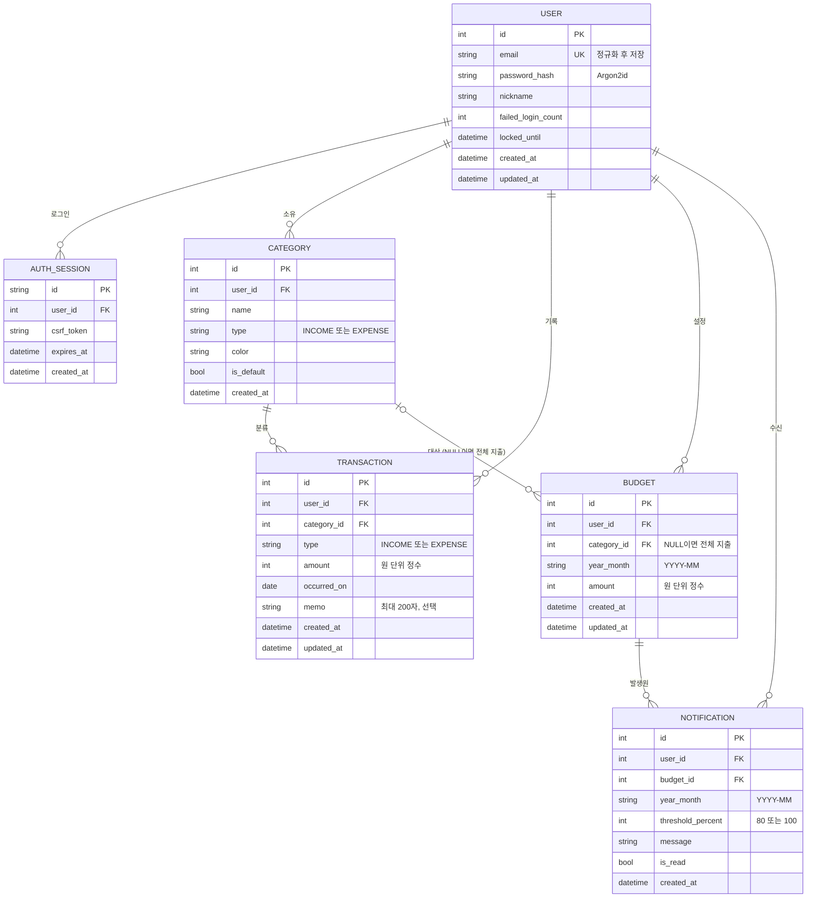

# 개인 가계부 앱 요구 사항 및 기획서

- 작성일: 2026-11-13
- 상태: 확정 (2026-11-13, 열린 질문 Q-A ~ Q-J는 권장 답안을 채택. 결정 기록: `docs/decisions/2026-11-13-open-questions.md`)
- 관련 문서/출처:
  - `docs/planning/2026-11-06-가계부-앱.md` (기존 확정 기획서. 이 문서는 그 내용과 충돌하지 않으며, 2026-11-06 확정 결정을 우선합니다)
  - `docs/api-contract.md` (백엔드와 프런트엔드 API 계약, 2026-11-06 구현 반영 변경 포함)
  - `docs/data-flow.md` (데이터 흐름과 2026-11-06 기준 완성도)
  - `ledger-app/backend/requirements.txt`, `ledger-app/frontend/package.json` (설치 버전 확인)

---

## 0. 사전 확인 결과 (작업 시작 전 확인)

이번 작업은 "새 프로젝트"가 아니라 **이미 구현이 진행된 프로젝트에 대한 기획 정리**입니다. 확인한 내용은 다음과 같습니다.

| 항목 | 확인 결과 |
|---|---|
| 기존 기획서 | `docs/planning/2026-11-06-가계부-앱.md` 존재, 상태 "확정". 기술 스택은 사용자 결정으로 FastAPI, SQLAlchemy, SQLite, React + Vite로 정해짐 (Next.js 안은 폐기) |
| 기존 API 계약 | `docs/api-contract.md` 존재 |
| 백엔드 | `ledger-app/backend/` 에 FastAPI 앱 존재. 라우터, 서비스, 리포지토리, 모델, 스키마, pytest 테스트 포함. 기록상 pytest 161개 통과 |
| 프런트엔드 | `ledger-app/frontend/` 에 React 19, Vite 7, TypeScript, react-router 7, Recharts 3 구성. 기록상 vitest 44개 통과 |
| 가상환경과 설치물 | `ledger-app/backend/.venv/`, `ledger-app/frontend/node_modules/` 존재 (설치 산출물이므로 구조 설명에서 제외) |
| Git | 브랜치 main, 커밋 1개 (Initial commit). 작업 트리 clean |

따라서 이 문서는 다음 원칙으로 작성합니다.
1. 기술 스택은 **2026-11-06 확정 결정을 그대로 따릅니다.** 이번에 스택을 바꾸지 않습니다.
2. 알림 방식, 차트 라이브러리, 인증 방식, 저장소처럼 아직 남은 선택지는 10장에서 비교하고 추천안을 고릅니다. 추천안은 대부분 현재 구현과 일치합니다.
3. 기능 목록의 "구현 상태"는 2026-11-06 문서의 완성도 기록을 인용한 것입니다. 이번 작업에서 코드를 실행해 다시 검증하지는 않았습니다.

---

## 1. 개요

### 1.1 배경과 문제
개인이 매달 얼마를 벌고 어디에 쓰는지 한눈에 파악하기 어렵습니다. 예산을 세워도 초과 사실을 월말에야 알게 되는 경우가 많습니다. 이 앱은 수입과 지출을 기록하고, 카테고리로 분류하고, 월별 지출을 그래프로 보여주고, 예산 초과 시 알림을 줌으로써 사용자가 지출을 미리 통제하도록 돕습니다.

### 1.2 한 줄 정의
"로그인한 개인이 수입과 지출을 기록하고 카테고리로 분류하며, 월별 지출을 그래프로 확인하고, 예산을 초과하면 알림을 받는 개인용 가계부 웹 앱"

---

## 2. 목표와 성공 기준

### 2.1 목표

| ID | 목표 |
|---|---|
| G-01 | 수입과 지출 거래를 빠짐없이 기록, 수정, 삭제할 수 있다. |
| G-02 | 거래를 카테고리로 분류하고, 사용자가 카테고리를 관리할 수 있다. |
| G-03 | 월별 지출을 그래프와 표로 한눈에 파악할 수 있다. |
| G-04 | 전체 지출과 카테고리별 월 예산을 설정하고, 초과 시 알림을 받는다. |
| G-05 | 사용자별 데이터가 완전히 분리되며, 안전하게 로그인할 수 있다. |

### 2.2 성공 기준 (측정 가능)

| ID | 기준 | 측정 방법 | 현재 상태 (2026-11-06 기록) |
|---|---|---|---|
| SC-01 | 거래 1건 입력(금액, 카테고리, 날짜, 저장)을 평균 15초 이내 완료 | 사용성 점검 시나리오 5회 평균 (권장 목표) | 미측정 |
| SC-02 | 거래 저장 후 예산 판정과 알림 생성까지 p95 1초 이내 | 거래 10,000건 테스트 계정에서 100회 측정 | 측정 통과 (2026-11-13, 저장 API p95 17.4ms, API 직접 호출. 화면 시간은 아님) |
| SC-03 | 월별 리포트 화면 p95 2.5초 이내 표시 | 거래 10,000건 기준 측정 | 측정 통과 (2026-11-13, 리포트 3종 API p95 21.8ms. 화면 렌더링 시간은 아직 미측정) |
| SC-04 | 예산 초과 판정 누락 0건 | 경계값 (79%, 80%, 99%, 100%, 100% 초과) 자동 테스트 전건 통과 | 판정 로직 테스트 존재, 경계값 전건 확인은 미기록 |
| SC-05 | 사용자 간 데이터 접근 0건 | 타 사용자 리소스의 조회, 수정, 삭제 시도 테스트 전건 404 | 격리 테스트(`test_isolation.py`) 존재 |
| SC-06 | MVP 필수 기능(9장 MVP 포함 목록)이 모두 동작 | FR별 통과 여부 | 백엔드 약 97.7%, 프런트엔드 약 90.9% (기능 기준) |
| SC-07 | 주요 시나리오 S-01~S-08을 오류 없이 완료 | E2E 테스트 또는 수동 시나리오 | 부분 통과 (2026-11-13, Vite 프록시 경유 API 흐름 16개 통과. 브라우저 화면 클릭 확인은 미수행) |

---

## 3. 사용자와 시나리오

### 3.1 대상 사용자
- 주 사용자: 월급이나 용돈을 받아 생활비를 관리하려는 개인 1인 (1인 1계정).
- 사용 환경: PC 브라우저와 모바일 브라우저 (반응형 웹). 네이티브 앱은 MVP 범위 밖.

### 3.2 사용 시나리오

| ID | 시나리오 | 흐름 요약 |
|---|---|---|
| S-01 | 최초 가입 | 이메일, 비밀번호, 닉네임으로 가입 → 자동 로그인 → 기본 카테고리 확인 |
| S-02 | 일상 지출 기록 | 점심 식사 후 금액, 날짜, "식비" 카테고리로 지출 입력 |
| S-03 | 수입 기록 | 월급일에 "급여" 수입 입력 |
| S-04 | 수정과 삭제 | 잘못 입력한 금액 수정, 중복 거래 삭제 |
| S-05 | 월말 점검 | 지난달로 이동해 수입, 지출, 잔액과 카테고리별 비율, 월별 추이 확인 |
| S-06 | 예산 설정 | 이번 달 전체 지출 예산과 "식비" 예산 설정 |
| S-07 | 초과 알림 | "식비" 사용액이 예산의 80%에 도달하면 알림, 100%를 넘으면 다시 알림 |
| S-08 | 탈퇴 | 설정 화면에서 비밀번호 확인 후 계정과 모든 데이터 삭제 |

---

## 4. 기능 요구 사항 (FR)

표기 규칙: 각 항목은 **입력 → 처리 → 출력** 순서입니다. 우선순위는 MVP(필수) 또는 P2(이후 단계)입니다. "구현 상태"는 2026-11-06 기록 기준입니다 (완료, 부분, 미구현).

### 4.1 회원과 인증

**FR-01 회원가입 (MVP, 완료)**
- 입력: 이메일, 비밀번호, 닉네임
- 처리: 이메일 형식 검사, 이메일 중복 검사 (대소문자 무시), 비밀번호 규칙 검사 (8자 이상, 영문과 숫자 포함), 비밀번호 Argon2id 해시 저장, 기본 카테고리 복사, 세션과 CSRF 토큰 발급
- 출력: 가입 후 자동 로그인하고 대시보드로 이동. 실패 시 항목별 오류 메시지.

**FR-02 로그인 (MVP, 완료)**
- 입력: 이메일, 비밀번호
- 처리: 계정 조회, 잠금 확인, 해시 비교, 실패 횟수 집계 (10분 내 5회 실패 시 15분 잠금), 세션 생성
- 출력: HttpOnly 세션 쿠키 발급 후 대시보드 이동. 실패 시 "이메일 또는 비밀번호가 올바르지 않습니다"만 표시. 잠금 시 `423`.

**FR-03 로그아웃 (MVP, 완료)**
- 입력: 로그아웃 버튼
- 처리: 서버 세션 즉시 무효화, 쿠키 삭제
- 출력: 로그인 화면 이동. 이후 보호 화면 접근은 로그인 화면으로 리디렉션.

**FR-04 회원 탈퇴 (MVP, 부분)**
- 입력: 비밀번호 재확인, 탈퇴 확인 체크
- 처리: 비밀번호 확인 (틀리면 `400`, `details.password`), 계정, 카테고리, 거래, 예산, 알림, 세션을 하나의 트랜잭션에서 삭제
- 출력: 쿠키 삭제 후 로그인 화면. 같은 이메일로 재가입 가능. 프런트엔드 탈퇴 흐름 테스트 없음.

**FR-05 비밀번호 재설정 (P2)**
- 입력: 가입 이메일
- 처리: 1회용 재설정 링크 (유효 30분 권장), 메일 발송, 새 비밀번호 저장
- 출력: 새 비밀번호로 로그인. 메일 인프라가 필요하므로 P2 (Q-03).

### 4.2 카테고리

**FR-06 기본 카테고리 제공 (MVP, 완료)**
- 입력: 가입 이벤트
- 처리: 기본 카테고리를 사용자 계정에 복사. 수입: 급여, 부수입, 용돈, 기타 수입. 지출: 식비, 카페/간식, 교통, 주거/관리비, 통신, 쇼핑, 문화/여가, 의료/건강, 교육, 경조사, 기타 지출
- 출력: 카테고리 관리 화면에 표시. 기본 카테고리도 이름 변경과 삭제 가능.

**FR-07 카테고리 추가 (MVP, 완료)**
- 입력: 이름 (1~20자, 같은 유형 안에서 중복 불가), 유형 (수입/지출), 색상 (선택, 기본 `#64748b`)
- 처리: 이름 공백 제거, 중복 검사, 사용자 범위 안에서 저장
- 출력: 목록에 즉시 추가. 중복은 `409`.

**FR-08 카테고리 수정 (MVP, 부분)**
- 입력: 카테고리 ID, 새 이름, 새 색상
- 처리: FR-07과 같은 검증
- 출력: 목록과 기존 거래 표시에 반영.
- 미구현: 유형(수입/지출) 변경. 열린 질문 Q-B 참고.

**FR-09 카테고리 삭제 (MVP, 완료)**
- 입력: 삭제할 카테고리, 대체 카테고리 (필수)
- 처리: 같은 유형의 대체 카테고리만 허용. 하나의 트랜잭션에서 거래를 대체 카테고리로 이동하고, 해당 카테고리의 예산과 알림을 삭제한 뒤 카테고리를 삭제. 중간 실패 시 전체 롤백.
- 출력: 삭제 완료 메시지. 삭제 전 확인 창에 옮겨질 거래 수를 표시합니다 (Q-C, `transaction_count`로 구현).

### 4.3 수입과 지출 거래

**FR-10 거래 기록 (MVP, 완료)**
- 입력: 유형 (수입/지출, 필수), 금액 (원 단위 정수, 1원 이상 999,999,999원 이하, 필수), 날짜 (선택, 기본값 오늘(KST), 미래 날짜 불가), 카테고리 (필수, 유형과 일치해야 함), 메모 (선택, 최대 200자)
- 처리: 클라이언트와 서버 모두에서 검증, 사용자 소유 확인, 거래 저장, 영향받는 예산 판정 (FR-20 호출)
- 출력: 목록에 즉시 추가. 응답에 `budget_status` 포함 (예산 진행 막대 갱신용).

**FR-11 거래 목록 조회 (MVP, 부분)**
- 입력: 기간 (`from`, `to`), 유형 필터, 카테고리 필터 (다중 선택), 정렬 (`date_desc` 기본, `amount_desc`, `amount_asc`), 페이지 (`page`, `size`)
- 처리: 사용자 범위 필터링, 페이지 단위 조회 (기본 20건)
- 출력: 날짜, 유형, 카테고리, 금액, 메모 목록과 페이지 이동. 결과가 없으면 "거래가 없습니다" 안내.
- 미구현 (UI): 금액순 정렬과 다중 카테고리 필터는 API에만 있고 화면 UI가 없음.

**FR-12 거래 수정 (MVP, 완료)**
- 입력: 거래 ID, 변경 항목 (FR-10과 같은 검증)
- 처리: 소유 확인, 저장, 이전 값과 새 값에서 영향받는 (월, 카테고리) 예산 재계산, 새로 넘은 임계치만 알림 생성 (기존 알림은 취소하지 않음, A-09)
- 출력: 목록과 리포트, 예산 사용률 갱신.

**FR-13 거래 삭제 (MVP, 완료)**
- 입력: 거래 ID, 삭제 확인 (확인 창 필수)
- 처리: 소유 확인, 영구 삭제 (복구 없음, Q-05), 영향받는 예산 재계산 (알림은 취소하지 않음)
- 출력: 목록과 리포트에서 제거, 예산 사용률 갱신.

### 4.4 월별 리포트와 그래프

**FR-14 월 선택 이동 (MVP, 완료)**
- 입력: 이전 달, 다음 달 버튼, 또는 월 선택 (미래 월 선택 불가)
- 처리: 선택 월의 기간 계산 (Asia/Seoul, 1일 00:00 ~ 말일 23:59:59)
- 출력: 해당 월 리포트 갱신.

**FR-15 월 요약 (MVP, 완료)**
- 입력: 선택 월
- 처리: 수입 합계, 지출 합계, 잔액 (수입 - 지출)
- 출력: 요약 카드 3개. 거래가 없으면 0원.

**FR-16 카테고리별 지출 분류 그래프 (MVP, 완료)**
- 입력: 선택 월
- 처리: 카테고리별 지출 합계와 비율, 금액 내림차순, 0원 카테고리 제외
- 출력: 도넛 차트와 같은 내용의 표 (표는 접근성 대체 수단).

**FR-17 월별 지출 추이 그래프 (MVP, 부분)**
- 입력: 기준 월 (기본값 선택 월), 기간 (6개월 또는 12개월, 기본 12개월)
- 처리: 월별 지출 합계, 거래 없는 달은 0원
- 출력: 막대 그래프와 같은 내용의 표.
- 미구현 (UI): 화면은 12개월 고정. API의 `months` 파라미터 선택 UI 없음.

### 4.5 예산

**FR-18 예산 설정 (MVP, 완료)**
- 입력: 대상 (전체 지출 또는 지출 카테고리 1개), 대상 월 (`YYYY-MM`), 금액 (원 단위 정수, 1원 이상, 999,999,999원 이하)
- 처리: 같은 대상, 같은 월의 예산이 있으면 `409`. 수입 카테고리는 대상 아님 (A-07).
- 출력: 예산 목록에 표시, 현재 사용액 기준 사용률 계산. 예산 생성과 수정에서는 알림을 만들지 않음 (계약 반영 변경 9번).

**FR-19 예산 사용률 표시 (MVP, 완료, 반올림 정책 미정)**
- 입력: 선택 월
- 처리: 사용률 = 지출 합계 / 예산 금액 × 100. 상태 구분: 정상 (0~79%), 주의 (80~99%), 초과 (100% 이상)
- 출력: 진행 막대, "사용 금액 / 예산 금액 (사용률 %)" 텍스트, 상태는 색상과 글자를 함께 표시.
- 주의: 99.6%를 "100%"로 반올림해 보이면 화면은 "초과"처럼 보이지만 판정은 "주의"가 되어 혼동을 줍니다. Q-A 참고.

**FR-20 예산 초과 판정 (MVP, 완료)**
- 입력: 거래 저장, 수정, 삭제 이벤트
- 처리: 영향받는 예산 (전체 예산 포함, 해당 월)의 지출 합계를 계산하고, 임계치 80%, 100% 도달 여부 판정. 판정은 정수 곱셈으로 비교 (권장, 10.4절 참고).
- 출력: 새로 넘은 임계치 목록을 FR-21에 전달. 넘지 않았으면 아무 동작 없음.

**FR-21 예산 알림 생성 (MVP, 완료)**
- 입력: FR-20의 판정 결과 (예산 ID, 월, 임계치)
- 처리: 같은 (예산, 월, 임계치) 알림이 이미 있으면 생성하지 않음. DB 유일 제약과 `ON CONFLICT DO NOTHING` 사용.
- 출력: 알림 1건. 예시 문구: "10월 전체 예산의 80%를 사용했습니다 (400,000원 / 500,000원)."

**FR-22 인앱 알림 확인 (MVP, 완료)**
- 입력: 알림 화면 진입, 알림 클릭, "모두 읽음" 버튼
- 처리: 최신순 조회, 읽음 처리 (`POST /api/notifications/{id}/read`, `POST /api/notifications/read-all`)
- 출력: 읽지 않은 개수를 헤더 아이콘에 표시. 알림 클릭 시 관련 예산 화면으로 이동 (이동 동작은 2026-11-06 기록에 없어 확인 필요).

### 4.6 이후 단계 (P2)

| ID | 기능 | 요약 |
|---|---|---|
| FR-23 | 이메일 또는 브라우저 푸시 알림 | 알림 생성 시 발송, 채널 설정, 발송 결과 기록 |
| FR-24 | 소셜 로그인 | 외부 인증 제공자 로그인, 계정 연결 또는 생성 |
| FR-25 | 거래 키워드 검색 | 메모, 카테고리 이름 부분 일치 검색 |
| FR-26 | 예산 복사 | 전월 예산을 대상 월로 복사 (덮어쓰기 확인) |
| FR-27 | CSV 내보내기 | 기간별 거래를 CSV로 다운로드 |
| FR-28 | 반복 거래 | 월세, 구독료를 매월 예정 거래로 생성 |
| FR-29 | 전월 대비 비교 | 선택 월과 전월의 증감액, 증감률 |
| FR-30 | PWA 설치 | 매니페스트, 서비스 워커, 홈 화면 추가 |

---

## 5. 비기능 요구 사항 (NFR)

| ID | 분류 | 요구 사항 | 기준 | 현재 상태 |
|---|---|---|---|---|
| NFR-01 | 보안 | 비밀번호는 Argon2id 해시로 저장. 평문을 로그나 응답에 남기지 않음 | 파라미터 리뷰 | 구현, 파라미터 리뷰 미완 |
| NFR-02 | 보안 | 세션 쿠키 HttpOnly, Secure, SameSite=Lax | 개발자 도구 확인 | 구현 (Secure는 HTTPS 배포 시 확인 필요) |
| NFR-03 | 보안 | 세션 14일 미사용 만료, 로그아웃 시 즉시 무효화 | 자동 테스트 | 구현. 만료 세션 정리 구현 (시작 시 + 24시간 주기, Q-F) |
| NFR-04 | 보안 | 모든 조회와 변경 쿼리에 로그인 사용자 ID 조건 포함 | 타 사용자 접근 테스트 | 구현, repositories 계층 집중 |
| NFR-05 | 보안 | POST, PUT, PATCH, DELETE에 CSRF 토큰 (`X-CSRF-Token`) 필수 | 자동 테스트 | 구현 |
| NFR-06 | 보안 | 모든 입력을 서버에서 재검증 | 검증 단위 테스트 | 구현 |
| NFR-07 | 보안 | 로그인 실패 잠금과 주요 API 요청 속도 제한 | 잠금 테스트 | 로그인 잠금 구현. 속도 제한은 로그인, 가입 (창당 10회), 거래 쓰기 (창당 60회)에 구현 (Q-E). 읽기 API는 미적용 |
| NFR-08 | 보안 | 전 구간 HTTPS, 보안 헤더 (CSP, HSTS 등) | 배포 환경 헤더 점검 | 미구현 (배포 전) |
| NFR-09 | 개인정보 | 수집 항목은 이메일, 닉네임, 비밀번호 해시로 최소화 | 가입 폼과 스키마 검토 | 구현 |
| NFR-10 | 개인정보 | 거래 금액, 메모는 민감 정보로 취급. 외부 로그, 추적 도구로 전송 금지 | 로그 샘플 점검 | 확인 필요 |
| NFR-11 | 개인정보 | 탈퇴 시 해당 사용자 데이터 전부 삭제, 백업 보관 기간 명시 | 탈퇴 후 DB 조회 0건 | 삭제 구현, 백업 기간 미정 (Q-07) |
| NFR-12 | 개인정보 | 공개 배포 시 개인정보 처리방침과 가입 동의 | 배포 전 체크리스트 | 비공개 배포 가정으로 보류 (Q-08) |
| NFR-13 | 성능 | 월 리포트 p95 2.5초 이내 (거래 10,000건) | SC-03 | 측정 통과 (p95 21.8ms, API 기준) |
| NFR-14 | 성능 | 거래 저장 API p95 500ms 이내 (예산 판정 포함) | 부하 테스트 | 측정 통과 (p95 17.4ms, 순차 100회. 동시 부하는 미측정) |
| NFR-15 | 성능 | 거래 목록은 페이지 단위 조회 | 쿼리 로그 확인 | 구현 |
| NFR-16 | 접근성 | WCAG 2.2 AA 목표. 키보드만으로 모든 기능 조작 가능 | 자동 점검과 수동 키보드 테스트 | 미검증 |
| NFR-17 | 접근성 | 차트마다 같은 내용의 표 제공. 색상만으로 상태 구분 금지 | 점검 체크리스트 | 구현 (차트 대체 표) |
| NFR-18 | 접근성 | 명도 대비 4.5:1 이상, 입력 label 연결, 오류 메시지 읽기 가능 | 자동 점검 도구 | 미검증 |
| NFR-19 | 호환성 | 최신 두 버전 Chrome, Edge, Firefox, Safari (데스크톱, 모바일) | 수동 테스트 매트릭스 | 미검증 |
| NFR-20 | 호환성 | 화면 너비 360px 이상에서 레이아웃 깨짐 없음 | 개발자 도구 점검 | 375px, 1280px 목 API로 확인 |
| NFR-21 | 가용성 | 월 가용성 99.0% 이상 (개인 프로젝트 권장). 일 1회 백업, 7일 보관 | 배포 후 모니터링 | 배포 전 |
| NFR-22 | 유지보수성 | 프런트엔드 TypeScript 엄격 모드, ESLint, 계층 분리 (페이지, 훅, API, 서비스, 리포지토리) | CI 린트와 타입 검사 | 구현 (ruff, eslint, tsc) |
| NFR-23 | 유지보수성 | DB 스키마 변경은 Alembic 마이그레이션으로만 관리 | 마이그레이션 이력 확인 | 구현 (`test_migrations.py`) |
| NFR-24 | 국제화 | 통화는 원(KRW) 정수 고정. 날짜는 Asia/Seoul 기준. UI는 한국어 | 금액 단위 테스트 | 구현 (`tzdata` 의존성 포함) |
| NFR-25 | 관측성 | 서버 오류 기록. 금액과 메모는 기록하지 않음 | 로그 점검 | 확인 필요 |

---

## 6. 제약 조건

| 구분 | 제약 |
|---|---|
| 플랫폼 | 웹 브라우저 기반, 반응형. 네이티브 앱 제외 |
| 기술 스택 | 백엔드 Python, FastAPI, SQLAlchemy, Pydantic, Alembic, pytest, ruff. 프런트엔드 React, Vite, TypeScript, react-router, Recharts, vitest, msw. 데이터베이스 SQLite (SQLAlchemy 접근, 나중에 PostgreSQL 전환 가능). 2026-11-06 확정 |
| 설치 버전 | `requirements.txt`와 `package.json`에 고정된 버전을 따름 (예: FastAPI 0.162.0, SQLAlchemy 2.1.8, React 19.3.1, Recharts 3.10.1). 버전 업그레이드는 별도 작업 |
| 인증 | 이메일과 비밀번호, 서버 세션 쿠키 방식. 외부 인증은 P2 |
| 금액 | 원 단위 정수. 소수점 입력과 저장 금지 |
| 시간대 | Asia/Seoul 고정. API 시각은 UTC ISO 8601 (`Z`)로 응답 (계약 반영 변경 11번) |
| 데이터 격리 | 1인 1계정. 공유 기능은 MVP 밖 |
| 금융 조언 | 투자 추천과 금융 조언 기능 없음 |
| 외부 서비스 | 호스팅, 메일, 푸시의 사양과 요금은 도입 시 공식 문서로 재확인. 이 문서는 특정 요금과 무료 한도를 사실로 쓰지 않음 |

---

## 7. 범위 (MVP / 이후 / 제외)

### 7.1 MVP 포함
- FR-01 ~ FR-04: 가입, 로그인, 로그아웃, 탈퇴
- FR-06 ~ FR-09: 기본 카테고리, 추가, 수정, 삭제
- FR-10 ~ FR-13: 거래 기록, 목록, 수정, 삭제
- FR-14 ~ FR-17: 월 이동, 월 요약, 카테고리 그래프, 월별 추이 그래프
- FR-18 ~ FR-22: 예산 설정, 사용률, 초과 판정, 알림 생성, 인앱 알림 확인
- NFR-01 ~ NFR-07, NFR-09 ~ NFR-11, NFR-15 ~ NFR-17, NFR-20, NFR-22 ~ NFR-24 (MVP 필수)
- NFR-08, NFR-12, NFR-13, NFR-14, NFR-16, NFR-18, NFR-19, NFR-21, NFR-25: 배포 전 점검 항목으로 MVP 출시 조건에 포함

### 7.2 이후 단계 (Phase 2)
- FR-05 비밀번호 재설정
- FR-23 이메일 또는 푸시 알림
- FR-24 소셜 로그인
- FR-25 키워드 검색, FR-26 예산 복사, FR-27 CSV 내보내기, FR-28 반복 거래, FR-29 전월 대비 비교, FR-30 PWA 설치
- 2단계 인증 (2FA)

### 7.3 하지 않을 것 (Out of scope)
- 네이티브 모바일 앱 (스토어 배포 포함)
- 은행, 카드 연동과 명세서 자동 수집
- 자산 관리 (주식, 부동산, 대출 상환 계산)
- 다중 통화와 환율
- 가족 또는 여러 사용자 간 공유
- 세금 계산, 연말정산
- 금융 조언, 투자 추천
- 영수증 OCR
- 다국어 (한국어만)

---

## 8. 가정 (Assumptions)

| ID | 가정 | 근거 |
|---|---|---|
| A-01 | 1차 플랫폼은 반응형 웹 | 설명에 모바일 전용 요구 없음. 2026-11-06 확정 |
| A-02 | 1인 1계정, 한국어 UI, 원화(KRW) | 설명의 "개인 가계부" |
| A-03 | 로그인은 이메일과 비밀번호 | 가장 단순. 외부 의존 없음 |
| A-04 | 알림은 앱 안의 알림 목록만 제공 (MVP) | 메일과 푸시 인프라가 추가로 필요 |
| A-05 | 거래는 수동 입력만 지원 | 설명에 자동 수집 요구 없음 |
| A-06 | 카테고리는 수입과 지출 유형을 각각 가지며 기본 세트 제공 | 설명의 "카테고리별 분류" |
| A-07 | 예산은 지출에만 설정 | 설명의 "예산 초과" 문맥 |
| A-08 | 예산 범위는 "전체 지출"과 "지출 카테고리 1개", 월 단위 | 설명의 "한 달에 얼마를 썼는지" |
| A-09 | 알림은 생성 후 거래 수정이나 삭제로 사용률이 내려가도 취소하지 않음 | 알림 이력의 일관성 |
| A-10 | 예산 판정은 거래 저장과 같은 요청에서 동기 처리 (작업 큐 없음) | 개인 규모 데이터 (수천 건 수준) |
| A-11 | 데이터 보관 기간 제한 없음. 탈퇴 시에만 삭제 | 개인 기록의 특성 |
| A-12 | 일정과 개발 예산은 명시되지 않음. 1인 개발 기준 점진적 출시 | 설명에 정보 없음 |
| A-13 | 사용자는 PC와 모바일 브라우저를 함께 사용 | 반응형 요구의 근거 |
| A-14 | 공개 배포 여부는 미정. 현재는 개인용 비공개 배포를 가정 | Q-08 |
| A-15 | 예산 금액 상한은 거래 금액과 같은 999,999,999원 | 구현 반영 (계약 변경 8번) |

---

## 9. 열린 질문 (Open Questions, 권장 답안 포함)

2026-11-06 기획서의 Q-01 ~ Q-13은 이미 결정되었습니다 (Q-01 스택 변경 포함, 나머지는 권장안 채택). 아래는 **현재 구현과 기획 사이에서 새로 확인이 필요한 항목**입니다.

| ID | 질문 | 권장 답안 | 이유 |
|---|---|---|---|
| Q-A | 사용률 표시를 반올림할지, 내림할지 결정해야 하나요? (예: 99.6%) | **표시는 내림 (소수점 이하 버림), 판정은 정수 비교** | 99.6%가 "100%"로 보이면 "초과"로 오해할 수 있음. 판정 결과와 화면 표시를 일치시킴 |
| Q-B | 카테고리 유형(수입/지출) 변경을 허용할까요? | **MVP에서는 제외 (유형은 생성 후 고정).** 필요하면 거래가 없을 때만 허용 | 구현 범위가 작고, 거래와 예산 재계산 복잡도를 줄임 |
| Q-C | 카테고리 삭제 전에 영향받는 거래 수를 보여줄까요? | **보여줌.** 카테고리 목록 응답에 `transaction_count`를 추가하거나 별도 조회 API 추가 | 삭제 전 확인 창에서 이동 건수를 알려야 사용자가 결과를 예측할 수 있음 (FR-09) |
| Q-D | "모두 읽음" API는 계약에 두고 유지할까요? | **유지.** 이미 구현되어 있고 알림 목록 UX에 필요 | 건별 읽음만 있으면 알림이 많을 때 불편 |
| Q-E | 일반 API 요청 속도 제한 (NFR-07)을 MVP에 포함할까요? | **MVP에 포함.** 최소한 로그인, 가입, 거래 쓰기 API에 적용 | 개인용이어도 무차별 요청에 노출될 수 있음. 구현은 단순한 메모리 기반 제한부터 시작 |
| Q-F | 만료 세션 정리 작업을 어떻게 할까요? | **앱 시작 시와 일 1회 정리 작업으로 만료 세션을 삭제** | `auth_sessions` 테이블이 계속 커지는 것을 막음 (NFR-03) |
| Q-G | 로그인 잠금 응답 (`423`)과 중복 가입 응답 (`409`)으로 계정 존재 여부가 드러나는 것을 허용할까요? | **허용 (현재 구현 유지).** 개인용 MVP이며 사용자 경험을 우선 | 2026-11-06 알려진 위험으로 기록됨. 공개 배포 시 재검토 (Q-08과 연결) |
| Q-H | 예산 알림 발생 후, 같은 달에 다시 80%를 넘으면 알림을 다시 만들까요? | **만들지 않음 (월별 임계치당 1건, A-09 유지)** | 중복 알림 방지 (FR-21) |
| Q-I | 성능 측정용 거래 10,000건 시드 데이터를 어떻게 만들까요? | **개발 전용 스크립트 (`scripts/`)로 생성, 운영 DB와 분리** | SC-02, SC-03, NFR-13, NFR-14 측정에 필요 |
| Q-J | 배포 위치와 호스팅 서비스는 무엇으로 할까요? (Q-13 미결) | **도입 직전 공식 문서로 요금과 무료 한도를 확인 후 결정.** 이번 문서에서는 특정 서비스를 정하지 않음 | 사실 확인 없이 정하면 안 됨. NFR-08, NFR-21과 연결 |

---

## 10. 설계

### 10.1 기술 선택지 비교 (남은 선택지 중심)

스택 자체(백엔드, 프런트엔드, DB)는 2026-11-06에 확정되었으므로 비교 대상에서 제외합니다. 아래는 아직 결정이 남은 영역입니다.

#### 10.1.1 알림 방식

| 항목 | A. 인앱 알림 (목록과 헤더 배지) | B. 이메일 알림 | C. 브라우저 푸시 알림 |
|---|---|---|---|
| 필요 인프라 | DB 테이블만 필요 | 메일 발송 서비스, 발신 도메인 설정 | 푸시 서비스, 서비스 워커, 구독 정보 저장 |
| 구현 난이도 | 낮음 | 중간 | 높음 (PWA 필요, FR-30과 연결) |
| 사용자 체감 | 앱에 들어와야 확인 | 앱을 열지 않아도 확인 | 앱을 열지 않아도 확인, 권한 요청 필요 |
| 개인정보 | 외부 전송 없음 | 메일 주소와 금액 정보가 외부 서비스로 나감 | 구독 정보와 알림 내용이 외부 서비스를 거침 |
| 적합성 | **MVP에 가장 적합** | P2 | P2 (PWA 이후) |

**추천: A (인앱 알림).** 외부 전송이 없어 NFR-10 (거래 내용을 외부로 보내지 않음)을 지키기 쉽고, 현재 구현과 일치합니다. B, C는 FR-23에서 같은 알림 생성 흐름을 재사용하도록 인터페이스만 분리해 두면 됩니다.

#### 10.1.2 차트 라이브러리

| 항목 | A. Recharts (현재 채택) | B. Chart.js 계열 | C. 직접 SVG 구현 |
|---|---|---|---|
| React 통합 | React 컴포넌트로 선언적으로 사용 | 래퍼 라이브러리를 거치는 경우가 많음 | 직접 구현 |
| 도넛, 막대 기본 지원 | 지원 (현재 CategoryDonutChart, MonthlyTrendChart 사용) | 지원 | 직접 구현 필요 |
| 접근성 | 차트 DOM 구조가 제한적이므로 대체 표를 함께 제공해야 함 (NFR-17) | 캔버스 기반이면 접근성 텍스트를 따로 제공해야 함 | 마크업을 직접 제어해 접근성 확보 가능 |
| 번들 크기 | 대시보드 진입 시 약 216kB gzip (2026-11-06 기록). 지연 로딩 검토 | 라이브러리에 따라 다름 | 가장 작음 |
| 적합성 | **유지 추천.** 이미 구현되어 있고 두 종류 차트가 충분 | 대체 가능 | 차트 종류가 늘어날 때 부담 |

**추천: A (Recharts 유지).** 번들 크기 문제는 지연 로딩으로 해결하고, 차트마다 대체 표를 두는 것을 규칙으로 유지합니다. 라이브러리 세부 사양은 이번 작업에서 재확인하지 않았습니다.

#### 10.1.3 인증 방식

| 항목 | A. 서버 세션 쿠키 (현재 채택) | B. JWT (브라우저 저장소에 보관) | C. 외부 인증 서비스 (BaaS 등) |
|---|---|---|---|
| 세션 즉시 무효화 | 가능 (DB에서 세션 삭제) | 어려움 (만료 전까지 유효) | 서비스 기능에 따름 |
| XSS 노출 | HttpOnly 쿠키라 자바스크립트에서 읽을 수 없음 | 저장소에 있으면 탈취 가능 | 서비스에 따름 |
| CSRF | SameSite와 CSRF 토큰 필요 (NFR-05 구현됨) | 헤더로 전송하면 상대적으로 덜 취약 | 서비스에 따름 |
| 구현 부담 | 세션 테이블, 정리 작업 필요 | 서명, 만료, 갱신 로직 필요 | 가장 낮음. 외부 의존 |
| 개인정보 | 자체 DB에 보관 | 자체 DB에 보관 | 인증 정보가 외부로 나감 |
| 적합성 | **유지 추천.** 로그아웃 즉시 무효화 (NFR-03)를 가장 단순하게 만족 | 로그아웃 무효화가 약함 | 외부 의존 최소화 원칙에 어긋남 |

**추천: A (서버 세션 쿠키 + Argon2id 해시).** 2026-11-06 기록과 일치합니다. 해시 파라미터 리뷰와 만료 세션 정리 (Q-F)를 남은 과제로 둡니다.

#### 10.1.4 저장소

| 항목 | A. SQLite (현재 채택) | B. PostgreSQL |
|---|---|---|
| 설치와 운영 | 파일 하나, 설치 불필요 | 서버 프로세스 필요, 호스팅 비용 가능 |
| 동시 쓰기 | 제약 있음 (단일 쓰기 잠금) | 다중 쓰기 강함 |
| 집계 쿼리 | 개인 규모 (수천~1만 건) 에서 충분 | 대규모에서도 안정적 |
| 전환 비용 | SQLAlchemy 사용으로 낮춤 | 기준 |
| 적합성 | **개인용 MVP에 추천** | 다중 사용자 운영 시 전환 |

**추천: A (SQLite).** 2026-11-06 확정. 전환 가능성을 위해 SQLAlchemy 접근과 Alembic 마이그레이션을 유지합니다. 공개 배포 시 PostgreSQL 전환을 다시 검토합니다.

### 10.2 전체 구조

```text
[브라우저: React 19 + Vite + TypeScript]
  pages → hooks → api/client.ts
        | HTTPS (로컬은 HTTP), JSON, HttpOnly 세션 쿠키, X-CSRF-Token 헤더
        v
[FastAPI]
  api/routes/*        입출력과 HTTP 상태 코드
  core/*              설정, 미들웨어, 오류 처리
        |
        v
[서비스]  auth, login_guard, category, transaction, budget, notification, report
        |
        v
[리포지토리]  모든 조회에 user_id 조건
        |
        v
[SQLAlchemy] -> [SQLite 파일]  (Alembic 마이그레이션)
```

원칙:
- 화면은 API를 직접 호출하지 않고 훅을 거칩니다.
- 계산 (사용률, 금액 포맷, 날짜 경계)은 순수 함수로 두고 단위 테스트합니다 (프런트 `src/lib`, 백엔드 `app/lib`).
- 모든 사용자 데이터는 `user_id`로 격리하며, 타인 리소스는 `404`로 응답합니다.

### 10.3 주요 모듈

| 모듈 | 책임 | 기능 ID |
|---|---|---|
| auth (service, route, login_guard) | 가입, 로그인, 로그아웃, 실패 잠금, 탈퇴 | FR-01~04, NFR-02, 03, 07 |
| session (repository, deps) | 세션 생성, 조회, 만료 갱신, 삭제 | FR-02, FR-03, NFR-03, 05 |
| category | 기본 카테고리 복사, 추가, 수정, 삭제 (거래 이동 포함) | FR-06~09 |
| transaction | 거래 CRUD, 필터, 페이지네이션, 검증 | FR-10~13 |
| report | 월 요약, 카테고리 집계, 월별 추이 | FR-14~17 |
| budget | 예산 CRUD, 사용률 계산, 임계치 판정 | FR-18~20 |
| notification | 알림 생성 (중복 방지), 목록, 읽음 처리 | FR-21, 22 |
| common (lib, core) | 금액과 날짜 유틸, 오류 형식, 로깅 (민감 정보 제외) | NFR-06, 10, 24, 25 |

### 10.4 데이터 모델 (구현 기준)

설계 원칙:
- 금액은 원 단위 정수로 저장합니다.
- 날짜 (거래일)와 시각 (생성, 수정)은 구분합니다. 시각은 UTC로 저장하고 응답 시 ISO 8601로 바꿉니다.
- 모든 사용자 소유 데이터는 `user_id`를 가지며, 모든 쿼리는 `user_id` 조건을 포함합니다.



> 주의: `AUTH_SESSION`, `failed_login_count`, `locked_until` 필드는 구현 모델 이름을 기준으로 옮겨 적은 것이며, 정확한 컬럼명은 `ledger-app/backend/app/models/`에서 확인해야 합니다. 이번 작업에서 모델 파일 내용은 읽지 않았습니다.

제약 (구현 목표):
- CATEGORY: (user_id, type, name) 유일
- BUDGET: (user_id, category_id, year_month) 유일. 전체 예산 (category_id NULL)의 중복은 DB 기능 차이를 고려해 별도 처리 (부분 유일 인덱스 또는 서비스 검사)
- NOTIFICATION: (budget_id, year_month, threshold_percent) 유일
- TRANSACTION: (user_id, occurred_on) 인덱스 (월별 집계 성능, NFR-13)
- USER: email 유일 (정규화 후 저장)
- 사용자 탈퇴 시 하위 데이터 전부 삭제. 카테고리 삭제는 거래 이동 후 삭제.

### 10.5 판정과 계산 규칙 (권장 구현)

- 사용률 비교는 실수 대신 정수 곱셈으로 판정합니다. 예: 지출 `spent`, 예산 `amount`일 때 `spent * 100 >= amount * 80`이면 80% 도달, `spent * 100 >= amount * 100`이면 100% 도달. 이렇게 하면 79.99999... 같은 부동소수점 오차가 없습니다.
- 표시용 사용률은 Q-A 결정에 따라 내림하여 표시합니다.
- 전체 예산의 지출은 해당 월의 모든 지출 거래 합계입니다. 카테고리 예산의 지출은 그 카테고리의 지출 거래 합계입니다.
- 판정 대상 (거래 저장, 수정, 삭제 시):
  - 이전 값과 새 값의 월과 카테고리 조합 각각에 대해 전체 예산과 카테고리 예산을 재계산합니다.
  - 새로 넘은 임계치 (80, 100)만 알림으로 만듭니다. 기존 알림은 취소하지 않습니다 (A-09).

### 10.6 데이터 흐름 (요약)

| 흐름 | 단계 요약 | 상세 |
|---|---|---|
| 가입과 로그인 | 정규화, 검증, 해시, 잠금 확인, 세션과 CSRF 발급 | `docs/data-flow.md` 흐름 1 |
| 거래 저장과 알림 | 검증, 거래 저장, 예산 판정, 알림 생성 (하나의 트랜잭션), 응답에 `budget_status` | `docs/data-flow.md` 흐름 2 |
| 거래 수정, 삭제 | 영향 범위 계산, 재계산, 새 임계치 알림 | `docs/data-flow.md` 흐름 3 |
| 월 리포트 | 월 범위 계산, 집계 쿼리 3종 (요약, 카테고리, 추이) | `docs/data-flow.md` 흐름 4 |
| 카테고리 삭제 | 같은 유형 확인, 거래 이동, 예산과 알림 삭제, 카테고리 삭제 (트랜잭션) | `docs/data-flow.md` 흐름 5 |
| 탈퇴 | 비밀번호 확인, 사용자 데이터 전부 삭제 (트랜잭션), 쿠키 삭제 | `docs/data-flow.md` 흐름 6 |
| 인증 요청 | 세션 조회, 만료 확인, 만료 시간 연장, 상태 변경 시 CSRF 비교 | `docs/data-flow.md` 흐름 7 |

API 상세는 `docs/api-contract.md`를 기준으로 합니다. 이 문서에 API를 다시 적지 않습니다.

---

## 11. 폴더 구조

아래 트리는 **현재 저장소에 실제로 존재하는 구조**입니다 (파일 목록 확인 기준). 설치 산출물 (`.venv`, `node_modules`)과 빌드 산출물은 제외합니다. 새로 추가할 항목은 `[제안]`으로 표시합니다. 이번 작업에서 새 폴더나 파일은 만들지 않았습니다.

### 11.1 디렉터리 트리

```text
p6_1Agent/                                  프로젝트 루트 (git 저장소, main)
├─ .claude/                                 에이전트와 명령 정의 (기존)
├─ 계획_agent.md                            계획 에이전트 비교 문서 (기존)
├─ docs/
│  ├─ planning/
│  │  ├─ 2026-11-06-가계부-앱.md            기존 확정 기획서
│  │  └─ 2026-11-13-personal-ledger-app.md  이 기획서
│  ├─ api-contract.md                       백엔드와 프런트엔드 API 계약
│  ├─ data-flow.md                          데이터 흐름과 완성도 기록
│  └─ decisions/                            [제안] 설계 결정 기록 (ADR). Q-B, Q-E 등 결정 기록용
└─ ledger-app/
   ├─ backend/                              FastAPI 백엔드
   │  ├─ app/
   │  │  ├─ main.py                         앱 생성, 라우터 등록, 미들웨어 설정
   │  │  ├─ constants.py                    기본 카테고리, 임계치 (80, 100), 상수
   │  │  ├─ api/
   │  │  │  ├─ deps.py                      인증 의존성 (세션, CSRF 확인)
   │  │  │  ├─ cookies.py                   세션 쿠키 속성 (HttpOnly, Secure, SameSite)
   │  │  │  └─ routes/
   │  │  │     ├─ auth.py                   가입, 로그인, 로그아웃, me, 탈퇴 (FR-01~04)
   │  │  │     ├─ categories.py             카테고리 API (FR-06~09)
   │  │  │     ├─ transactions.py           거래 API (FR-10~13)
   │  │  │     ├─ reports.py                리포트 API (FR-14~17)
   │  │  │     ├─ budgets.py                예산 API (FR-18~20)
   │  │  │     └─ notifications.py          알림 API (FR-21~22)
   │  │  ├─ core/
   │  │  │  ├─ config.py                    환경 변수 설정 (pydantic-settings)
   │  │  │  ├─ security.py                  Argon2id 해시, 토큰 생성
   │  │  │  ├─ clock.py                     현재 시각 주입 (테스트 용이성, KST 기준)
   │  │  │  ├─ errors.py                    공통 오류 타입
   │  │  │  ├─ exception_handlers.py        오류를 계약 형식 (`error.code`)으로 변환
   │  │  │  └─ middleware.py                보안 헤더, 요청 처리 미들웨어
   │  │  ├─ db/
   │  │  │  ├─ base.py                      SQLAlchemy 선언 베이스
   │  │  │  └─ session.py                   DB 세션 팩토리
   │  │  ├─ models/                         SQLAlchemy 모델 (user, auth_session, category, transaction, budget, notification)
   │  │  ├─ schemas/                        Pydantic 요청과 응답 스키마 (검증 규칙 포함)
   │  │  ├─ repositories/                   DB 접근. 모든 조회에 user_id 조건 (NFR-04)
   │  │  ├─ services/                       비즈니스 규칙
   │  │  │  ├─ auth_service.py              가입, 로그인, 탈퇴
   │  │  │  ├─ login_guard.py               실패 횟수, 잠금
   │  │  │  ├─ category_service.py          카테고리 CRUD, 삭제 시 거래 이동
   │  │  │  ├─ transaction_service.py       거래 CRUD, 영향 범위 계산
   │  │  │  ├─ budget_service.py            예산 CRUD, 사용률, 임계치 판정
   │  │  │  ├─ notification_service.py      알림 생성 (중복 방지), 목록, 읽음
   │  │  │  ├─ report_service.py            월 요약, 카테고리, 추이 집계
   │  │  │  └─ common.py                    서비스 공통 도우미
   │  │  └─ lib/                            순수 함수 (DB, 네트워크 의존 없음)
   │  │     ├─ money.py                     원 단위 검증, 사용률 계산
   │  │     ├─ dates.py                     월 범위, Asia/Seoul 처리
   │  │     └─ messages.py                  사용자 메시지 문구
   │  ├─ tests/
   │  │  ├─ conftest.py                     테스트 DB, 클라이언트 픽스처
   │  │  ├─ helpers.py                      가입, 로그인, 거래 생성 도우미
   │  │  ├─ unit/                           금액, 날짜, 검증, 보안, 잠금 (SC-04)
   │  │  └─ integration/                    API와 DB 연동, 격리 (SC-05), 알림, 리포트, 마이그레이션
   │  ├─ migrations/ (Alembic 디렉터리, 경로는 alembic.ini에서 확인)   마이그레이션 이력 (NFR-23)
   │  ├─ alembic.ini                        Alembic 설정
   │  ├─ pyproject.toml                     프로젝트 메타데이터, ruff, pytest 설정
   │  ├─ requirements.txt                   고정 버전 의존성 (런타임과 개발용)
   │  ├─ .env.example                       환경 변수 예시 (실제 값 제외)
   │  ├─ README.md                          백엔드 실행 방법
   │  ├─ .venv/                             (산출물, 제외)
   │  └─ [제안] scripts/seed_perf.py        성능 측정용 거래 10,000건 생성 (Q-I)
   └─ frontend/                             React + Vite 프런트엔드
      ├─ package.json                       스크립트 (dev, build, typecheck, lint, test)
      ├─ vite.config.ts                     Vite 설정, 개발 서버 프록시
      ├─ node_modules/                      (산출물, 제외)
      └─ src/
         ├─ main.tsx                        진입점
         ├─ App.tsx                         라우팅 정의
         ├─ api/
         │  ├─ client.ts                    fetch 래퍼, CSRF 헤더, 오류 변환
         │  ├─ endpoints.ts                 엔드포인트 경로 상수
         │  └─ types.ts                     API 응답 타입 (계약 기준)
         ├─ auth/
         │  ├─ AuthContext.ts               인증 상태 컨텍스트 정의
         │  └─ AuthProvider.tsx             로그인 상태 제공자
         ├─ hooks/                          화면과 API 사이 (categories, transactions, reports, budgets, notifications, useAsync, usePageTitle)
         ├─ lib/                            순수 함수 (money, date, validation, focus)
         ├─ components/
         │  ├─ ui/                          Button, Field, Alert, Modal, ProgressBar, StatusBadge, Pagination, StateViews
         │  ├─ charts/                      CategoryDonutChart, MonthlyTrendChart (차트마다 대체 표 포함)
         │  ├─ layout/                      AppLayout (헤더, 알림 배지), ProtectedRoute (로그인 확인)
         │  └─ MonthNavigator.tsx           월 이동 컴포넌트
         ├─ pages/
         │  ├─ LoginPage.tsx                FR-02
         │  ├─ SignupPage.tsx               FR-01
         │  ├─ DashboardPage.tsx            FR-14~17
         │  ├─ TransactionsPage.tsx         FR-11 (목록)
         │  ├─ transactions/TransactionFormDialog.tsx   FR-10, 12 (입력과 수정)
         │  ├─ CategoriesPage.tsx           FR-06~09
         │  ├─ BudgetsPage.tsx              FR-18~19
         │  ├─ NotificationsPage.tsx        FR-22
         │  ├─ SettingsPage.tsx             FR-03 (로그아웃), FR-04 (탈퇴)
         │  └─ NotFoundPage.tsx             404 화면
         ├─ test/                           테스트 도구 (msw 서버, 핸들러, 픽스처, 렌더 도우미)
         └─ *.test.ts(x)                    단위 테스트는 lib, api, 페이지 옆에 둠
```

### 11.2 폴더 역할 요약

| 경로 | 역할 | 관련 요구 사항 |
|---|---|---|
| `docs/planning/` | 기획서 보관 (날짜별 파일) | 전체 |
| `docs/api-contract.md` | 프런트와 백엔드가 공유하는 계약. 바꿀 때 먼저 수정 | 전체 API |
| `docs/data-flow.md` | 흐름과 완성도 기록 | 전체 |
| `ledger-app/backend/app/api/routes/` | HTTP 입출력만 담당. 비즈니스 규칙 없음 | FR-01~22 |
| `ledger-app/backend/app/services/` | 판정, 재계산, 트랜잭션 규칙의 중심 | FR-09, 18~21 |
| `ledger-app/backend/app/repositories/` | DB 접근 한 곳. user_id 조건 누락 방지 | NFR-04 |
| `ledger-app/backend/app/lib/`, `core/security.py` | 순수 계산과 해시. 단위 테스트 대상 | NFR-01, 24, SC-04 |
| `ledger-app/backend/migrations/` | 스키마 변경 이력 | NFR-23 |
| `ledger-app/backend/tests/` | 단위와 통합 테스트 분리 | 13장 |
| `ledger-app/frontend/src/api/` | 서버 호출 한 곳 | 계약 준수 |
| `ledger-app/frontend/src/hooks/` | 화면과 API 사이. 화면은 직접 API를 부르지 않음 | NFR-22 |
| `ledger-app/frontend/src/components/charts/` | 차트와 대체 표 | NFR-17 |
| `ledger-app/frontend/src/components/ui/` | 공통 부품 (상태 표시는 색상과 글자 함께) | NFR-16, 18 |

---

## 12. 작업 분해 및 단계별 계획

### 12.1 현재 진행 상태 (2026-11-06 기록 기준)

| Epic | 내용 | 상태 |
|---|---|---|
| E0 기반 | 프로젝트 골격, 린트와 테스트, DB 마이그레이션 | 완료 |
| E1 인증 | 가입, 로그인, 로그아웃, 잠금, 탈퇴 | 완료 (탈퇴 프런트 테스트 보완 필요) |
| E2 카테고리 | 기본 카테고리, 추가, 수정, 삭제 | 대부분 완료 (유형 변경 제외, Q-B) |
| E3 거래 | 입력, 목록, 수정, 삭제 | 완료 (목록 UI의 정렬과 다중 필터 보완) |
| E4 리포트 | 월 이동, 요약, 그래프, 추이 | 완료 (추이 기간 선택 UI 보완) |
| E5 예산과 알림 | 설정, 사용률, 판정, 알림, 확인 | 완료 (반올림 정책 Q-A 결정 필요) |
| E6 품질 | 접근성, 성능, 보안, 개인정보 점검 | 미완료 |

### 12.2 남은 작업 (우선순위 순)

| 순위 | 작업 | 관련 | 완료 조건 |
|---|---|---|---|
| 1 | 실제 백엔드와 프런트엔드 연동 확인 (가입, 거래 기록, 예산 알림, 탈퇴) | SC-07, S-01~S-08 | 수동 시나리오 또는 E2E 통과 기록 |
| 2 | 열린 질문 Q-A, Q-C 결정과 반영 (사용률 표시, 삭제 전 거래 수) | FR-09, FR-19 | 결정 문서화, 테스트 추가 |
| 3 | 일반 API 속도 제한과 만료 세션 정리 (Q-E, Q-F) | NFR-03, 07 | 자동 테스트 통과 |
| 4 | 거래 10,000건 시드와 성능 측정 (Q-I) | SC-02, SC-03, NFR-13, 14 | p95 측정 결과 기록 |
| 5 | 동시성 테스트 (알림 중복 방지) | R-04, FR-21 | 동시 요청 2건에도 알림 1건 |
| 6 | 목록 정렬과 다중 필터 UI, 추이 기간 선택 UI | FR-11, 17 | 화면 동작과 테스트 |
| 7 | 접근성 점검 (키보드, 대비, label) | NFR-16~18 | 체크리스트 통과 |
| 8 | 보안 헤더, HTTPS, Argon2 파라미터 리뷰 | NFR-01, 02, 08 | 배포 환경 점검 기록 |
| 9 | 배포 (Q-J), 백업 정책, 처리방침 초안 | NFR-08, 11, 12, 21 | 배포 체크리스트 완료 |
| 10 | 차트 지연 로딩 (번들 크기) | 성능 | 대시보드 번들 크기 감소 기록 |

### 12.3 단계 정의 (Milestone)

| 단계 | 범위 | 완료 조건 (Definition of Done) |
|---|---|---|
| M0 기반 | E0 | 빌드, 테스트, 린트 통과. 빈 화면 열림 |
| M1 인증과 카테고리 | E1, E2 | FR-01~04, 06~09 수용 기준 통과, 격리 테스트 통과 |
| M2 거래 | E3 | FR-10~13 통과, 금액과 날짜 검증 단위 테스트 통과 |
| M3 리포트 | E4 | FR-14~17 통과, SC-03 측정 통과 (거래 10,000건) |
| M4 예산과 알림 | E5 | FR-18~22 통과, SC-04 경계값 테스트 전건 통과 |
| M5 품질과 출시 | E6 | NFR 전체 점검 완료, SC-06, SC-07 통과, 비공개 배포 |

현재 위치: **M4 완료 수준, M5 진입 전.** 남은 작업은 12.2의 1번부터 시작합니다.

### 12.4 의존 관계
- 연동 확인 (12.2의 1번)은 다른 품질 작업보다 먼저 진행합니다. 실제 흐름이 깨지면 나머지 측정이 의미 없기 때문입니다.
- 성능 측정 (4번)은 시드 데이터 (Q-I)가 필요합니다.
- 배포 (9번)는 보안 (3번, 8번)과 개인정보 점검 이후입니다.

---

## 13. 위험 요소

| ID | 위험 | 영향 | 가능성 | 완화 방안 |
|---|---|---|---|---|
| R-01 | 인증 구현 실수 (세션 탈취, 해시 설정) | 높음 | 중간 | 검증된 라이브러리, 설정 체크리스트, 보안 리뷰 |
| R-02 | 사용자 격리 누락 | 매우 높음 | 중간 | repositories에서만 DB 접근, 격리 테스트를 CI에 포함 (SC-05) |
| R-03 | 예산 재계산 누락 (수정, 삭제 시) | 중간 | 중간 | 영향 범위 계산 단위 테스트, 경계값 테스트 |
| R-04 | 알림 중복 또는 누락 | 중간 | 중간 | 유일 제약, 트랜잭션, 동시성 테스트 (미검증 상태) |
| R-05 | 월 경계와 시간대 오류 (UTC와 KST) | 중간 | 중간 | Asia/Seoul 유틸 한 곳, 월말 경계 테스트 |
| R-06 | 금액 부동소수점 오류 | 높음 | 낮음 | 정수 저장, 판정은 정수 곱셈 비교 (10.5절) |
| R-07 | 거래가 많아져 리포트가 느려짐 | 중간 | 낮음 | (user_id, occurred_on) 인덱스, SC-03 측정 |
| R-08 | 설치 버전 또는 외부 사양 변화 | 중간 | 중간 | 버전 고정 (requirements.txt, package.json), 업그레이드는 별도 작업 |
| R-09 | 사용률 반올림 혼동 (99.6% 표시) | 중간 | 높음 | Q-A 결정 (표시 내림) |
| R-10 | SQLite 동시 쓰기 제약 | 낮음 (개인용) | 낮음 | 다중 사용자 전환 시 PostgreSQL 검토 |
| R-11 | 계정 존재 여부 노출 (423, 409 응답) | 낮음 | 중간 | Q-G 수용 여부 결정, 공개 배포 시 재검토 |
| R-12 | 차트 중심 UI의 접근성 미흡 | 중간 | 중간 | 차트와 대체 표 병행, 키보드 점검 |
| R-13 | 범위 확장 (소셜 로그인, 은행 연동 요청) | 중간 | 높음 | 7.3절 제외 범위를 기준으로 변경 요청 관리 |
| R-14 | 문서와 구현 불일치 (기획서, 계약, 실제 코드) | 중간 | 중간 | 계약 변경 시 `api-contract.md`를 먼저 수정, 기획서 상태 갱신 |

---

## 14. 검증 계획

| 검증 방식 | 대상 | 도구 | 시점 |
|---|---|---|---|
| 단위 테스트 (백엔드) | 금액, 날짜 경계, 사용률, 검증 규칙, 해시, 잠금 | pytest (설치 버전 9.2.0) | 매 변경 |
| 단위 테스트 (프런트) | lib, api 클라이언트, 페이지 | vitest (4.1.12), @testing-library | 매 변경 |
| 통합 테스트 (백엔드) | API와 DB, 트랜잭션 (카테고리 삭제, 탈퇴), 격리 (SC-05), 알림 | pytest + 테스트 DB | 매 변경 |
| 린트, 타입 | 백엔드 ruff, 프런트 eslint, tsc | 각 도구 | 매 변경 |
| 연동 확인 | 실제 백엔드와 프런트엔드 시나리오 S-01~S-08 | 수동 체크리스트 (E2E 도구는 도입 시 확정) | 12.2의 1번, M5 |
| 성능 측정 | SC-02, SC-03, NFR-13, NFR-14 (거래 10,000건) | 부하 도구는 도입 시 확정 | M3, M4, M5 |
| 접근성 점검 | NFR-16~18 (키보드, 대비, label) | 자동 점검 도구와 수동 키보드 테스트 | M3, M5 |
| 보안 점검 | NFR-01~08 (세션 속성, CSRF, 잠금, 헤더) | 수동 체크리스트 + 의존성 점검 | M1, M5 |
| 개인정보 점검 | NFR-09~12, 로그에 거래 내용 없음 | 로그 샘플 검토, 탈퇴 후 DB 조회 | M1, M5 |

### 14.1 요구 사항별 검증 매핑 (발췌)

| 요구 사항 | 검증 | 통과 기준 |
|---|---|---|
| FR-02 로그인 잠금 | 통합 | 10분 내 5회 실패 후 잠금 (`423`), 15분 후 해제 |
| FR-09 카테고리 삭제 | 통합 | 거래 이동 후 삭제, 중간 실패 시 전부 롤백 |
| FR-10 금액 검증 | 단위 | 0원, 음수, 999,999,999원 초과, 소수점 입력 거부 |
| FR-14 월 경계 | 단위 | 2월 말일, 12월 31일 23:59 (KST) 거래가 올바른 월에 집계 |
| FR-19 사용률 표시 | 단위 | 79.4%는 정상, 80%는 주의, 100%는 초과. 99.6%는 표시와 판정이 일치 (Q-A) |
| FR-20 예산 판정 | 단위 | 79/80/99/100/100 초과 경계값 전건 통과 (SC-04) |
| FR-21 알림 중복 방지 | 통합, 동시성 | 같은 임계치 재도달 시 알림 1건. 동시 요청 2건에도 1건 |
| NFR-04, SC-05 격리 | 통합 | 타 사용자 거래, 예산, 알림 ID로 조회, 수정, 삭제 시 404 |
| NFR-05 CSRF | 통합 | 토큰 없음 또는 다른 값이면 403 |
| NFR-16 키보드 조작 | 수동 | 가입부터 예산 설정까지 마우스 없이 완료 |

---

## 부록: 참고 자료

1. `docs/planning/2026-11-06-가계부-앱.md` (기존 확정 기획서, 스택과 Q-01~Q-13 결정)
2. `docs/api-contract.md` (API 계약, 구현 반영 변경 1~12)
3. `docs/data-flow.md` (데이터 흐름, 완성도 기록)
4. `ledger-app/backend/requirements.txt`, `ledger-app/frontend/package.json` (설치 버전)
5. WCAG 2.2 (W3C Recommendation, 2023) 접근성 기준 (2026-11-06 기획서 인용, 이번 작업에서 재확인하지 않음)
6. Core Web Vitals 권장 기준 (LCP 2.5초 이하) (2026-11-06 기획서 인용, 이번 작업에서 재확인하지 않음)

> 참고: 라이브러리와 프레임워크의 세부 사양, 버전별 차이, 요금은 이번 작업에서 웹에서 확인하지 않았습니다. 버전 업그레이드나 배포 서비스 선택 전에 공식 문서로 확인해야 합니다.
